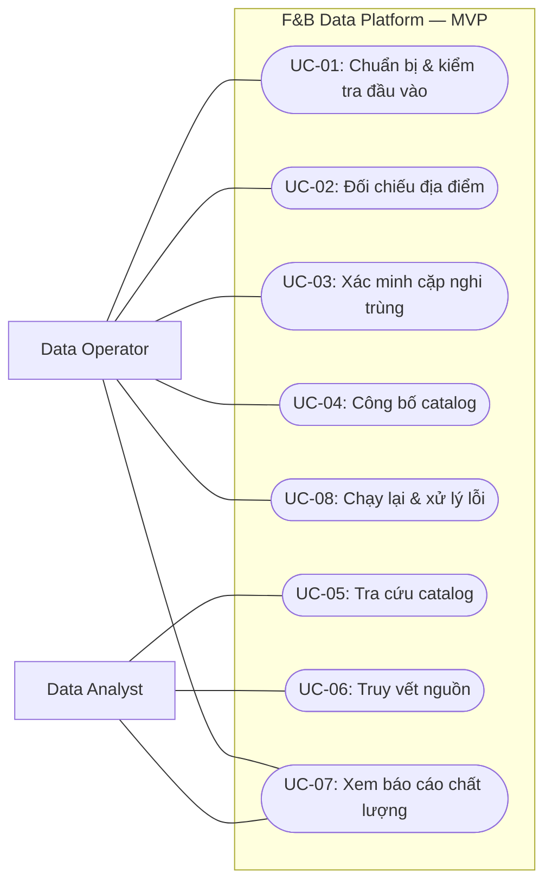

# F&B Data Integration & Recommendation Platform

**Use Case Specification**\
**Phiên bản:** 1.0 · **Ngày:** 28/10/2026 · **Trạng thái:** Draft — chờ duyệt\
**Liên quan:** `01_BRD.md`, `02_PRD.md`, `03_SRS.md` · **MVP:** Phường Khánh Hội, TP.HCM

## 1. Mục đích và phạm vi

Tài liệu mô tả **người sử dụng làm gì với hệ thống và hệ thống phản hồi ra sao**. Mỗi use case có điều kiện bắt đầu, luồng thành công, tình huống thay thế và lỗi. Đây không phải tài liệu thiết kế cơ sở dữ liệu, API hay thuật toán Entity Resolution.

**MVP** tạo danh mục F&B thống nhất từ **Overture Maps + OpenStreetMap (OSM)** ở phường Khánh Hội. Người dùng có thể thao tác qua **CLI, file dữ liệu và SQL**; **không bắt buộc có website**. Crawler đã có trong repository nhưng không cần chạy live để hoàn thành MVP. Reviews và recommendation thuộc release sau, chỉ dùng dữ liệu có quyền sử dụng phù hợp.

## 2. Actors và ranh giới hệ thống

| Actor | Vai trò | Quyền/tác vụ nghiệp vụ |
|---|---|---|
| **Data Operator** | Chuẩn bị đầu vào, chạy pipeline và xử lý ngoại lệ | Chọn snapshot; kiểm tra cặp nghi trùng; công bố, chạy lại, xem lỗi |
| **Data Analyst** | Khai thác dữ liệu đã công bố | Tìm/lọc cửa hàng, xem nguồn và báo cáo chất lượng |
| **Người tìm quán** *(Release 3)* | Sử dụng kết quả gợi ý | Tìm quán theo nhu cầu và xem lý do xếp hạng |

**Overture và OSM là nguồn dữ liệu bên ngoài**, không phải người thực hiện thao tác. Scheduler tự động (nếu bổ sung sau) chỉ kích hoạt quy trình đã có; không cần tạo actor nghiệp vụ mới trong MVP. Các công việc như chuẩn hóa, candidate generation và quality gates là bước xử lý nội bộ, không phải mỗi bước đều cần một use case người dùng riêng.

## 3. Sơ đồ Use Case — MVP

**Luồng thực hiện điển hình:** UC-01 → UC-02 → (UC-03 nếu cần) → UC-04 → UC-05/06/07. UC-08 có thể được dùng khi cần chạy lại hoặc khi một lần chạy thất bại. Sơ đồ thể hiện tương tác, không đồng nghĩa mỗi use case là một service/API riêng.

## 4. Danh sách Use Case

| ID | Use Case | Actor chính | Phạm vi | Liên kết PRD / SRS |
|---|---|---|---|---|
| **UC-01** | Chuẩn bị và kiểm tra dữ liệu đầu vào | Operator | MVP | PF-01–03; FR-01–05 |
| **UC-02** | Đối chiếu các bản ghi địa điểm | Operator | MVP | PF-04; FR-06–08, FR-18 |
| **UC-03** | Xác minh cặp nghi trùng | Operator | MVP | PF-05; FR-09 |
| **UC-04** | Công bố danh mục thống nhất | Operator | MVP | PF-06–07, PF-10; FR-10–12, FR-15, FR-17 |
| **UC-05** | Tìm kiếm và lọc cửa hàng | Analyst | MVP | PF-08; FR-13 |
| **UC-06** | Truy vết thông tin về nguồn | Analyst | MVP | PF-07; FR-11–12 |
| **UC-07** | Xem báo cáo chất lượng và kết quả matching | Analyst / Operator | MVP | PF-09; FR-14, FR-18 |
| **UC-08** | Chạy lại và xử lý lần chạy thất bại | Operator | MVP | PF-10; FR-15–17 |
| **UC-09** | Cập nhật danh mục theo snapshot mới | Operator | Release 2 | PF-11; FR-19 |
| **UC-10** | Liên kết và phân tích reviews hợp lệ | Operator / Analyst | Release 2 | PF-12–13; FR-20–21 |
| **UC-11** | Tìm và nhận gợi ý địa điểm | Người tìm quán | Release 3 | PF-14–15; FR-22–23 |
| **UC-12** | Theo dõi cập nhật dữ liệu | Operator | Release 2–3 | PF-16; FR-24 |

## 5. Đặc tả Use Case MVP

### UC-01 — Chuẩn bị và kiểm tra dữ liệu đầu vào

**Actor:** Data Operator · **Mục tiêu:** Có tập POI hợp lệ, cùng phạm vi và được ghi nhận nguồn gốc.\
**Kích hoạt:** Operator bắt đầu xử lý một bộ snapshot.\
**Điều kiện trước:** Có quyền đọc snapshot Overture/OSM; có polygon Khánh Hội và quy tắc phân loại F&B đã được xác định.\
**Thành công:** Có tập bản ghi đủ điều kiện cho matching, danh sách bản ghi bị loại/cách ly và thông tin phiên bản đầu vào.

**Luồng chính**
1. Operator chọn hai snapshot, phiên bản polygon và cấu hình phân loại.
2. Hệ thống kiểm tra có thể đọc dữ liệu, ghi nguồn, phiên bản, thời điểm và `run_id`.
3. Hệ thống kiểm tra định danh, tọa độ và các trường dữ liệu cần thiết; thống kê bản ghi không hợp lệ.
4. Hệ thống lọc theo **polygon** và loại hình F&B; giữ nhãn nguồn và lý do loại trừ.
5. Hệ thống chuẩn hóa các thuộc tính phục vụ đối chiếu, đồng thời giữ thông tin gốc để truy vết.
6. Operator xem số bản ghi đọc được, giữ lại, loại/cách ly trước khi tiếp tục.

**Thay thế:** Dữ liệu thiếu địa chỉ hoặc số điện thoại vẫn được giữ nếu đáp ứng điều kiện tối thiểu; hệ thống đánh dấu trường thiếu.\
**Ngoại lệ:** Snapshot không đọc được, polygon không hợp lệ hoặc thiếu metadata bắt buộc → báo lỗi, không chuyển sang matching; không công bố output mới.\
**Kiểm tra liên quan:** AT-01, AT-02.

### UC-02 — Đối chiếu các bản ghi địa điểm

**Actor:** Data Operator · **Mục tiêu:** Xác định record nào cùng chi nhánh và record nào cần xem xét thêm.\
**Kích hoạt:** Operator yêu cầu đối chiếu tập dữ liệu đã kiểm tra.\
**Điều kiện trước:** UC-01 hoàn thành; có rule version và dữ liệu chuẩn hóa.\
**Thành công:** Các cặp được xét có trạng thái `match`, `non-match` hoặc `review`, có bằng chứng và phiên bản quy tắc.

**Luồng chính**
1. Hệ thống tạo các cặp ứng viên có khả năng đại diện cho cùng chi nhánh.
2. Hệ thống so sánh tên, vị trí, địa chỉ và những thông tin hỗ trợ khác nếu có.
3. Hệ thống lưu bằng chứng, điểm số hoặc lý do đánh giá và quy tắc đã sử dụng.
4. Hệ thống phân loại từng cặp thành `match`, `non-match` hoặc `review`.
5. Operator xem thống kê và các trường hợp có nguy cơ gộp nhầm.

**Thay thế:** Hai cửa hàng cùng thương hiệu nhưng khác vị trí/chi nhánh → không tự động gộp chỉ vì tên giống. Cặp thiếu bằng chứng → đưa vào `review`.\
**Ngoại lệ:** Thiếu cấu hình matching, dữ liệu đầu vào không hợp lệ hoặc bước xử lý thất bại → ghi nhận lần chạy lỗi, không dùng kết quả dở dang để công bố.\
**Kiểm tra liên quan:** AT-03, AT-04, AT-10.

### UC-03 — Xác minh cặp nghi trùng

**Actor:** Data Operator · **Mục tiêu:** Đưa ra quyết định có căn cứ cho các cặp chưa chắc chắn.\
**Kích hoạt:** Xuất hiện cặp có trạng thái `review`.\
**Điều kiện trước:** Có cặp ứng viên, bản ghi nguồn và bằng chứng đối chiếu.\
**Thành công:** Quyết định `match`, `non-match` hoặc **giữ chưa xác định** được lưu cùng người/nguồn quyết định, thời điểm và lý do.

**Luồng chính**
1. Operator mở danh sách các cặp cần xem xét (file hoặc CLI trong MVP).
2. Hệ thống hiển thị hai record gốc và bằng chứng liên quan: tên, địa chỉ, tọa độ, nguồn, khoảng cách nếu có.
3. Operator chọn `match`, `non-match` hoặc để lại `review`; ghi lý do.
4. Hệ thống kiểm tra tính hợp lệ của quyết định và lưu lịch sử xác minh.
5. Lần chạy liên quan sử dụng quyết định đã được ghi nhận theo phiên bản phù hợp.

**Thay thế:** Không có đủ thông tin → giữ `review` và **không ép gộp**; có thể tiếp tục công bố các cửa hàng khác theo chính sách đã chốt.\
**Ngoại lệ:** Quyết định mâu thuẫn với quyết định đã xác nhận hoặc tham chiếu đến record không tồn tại → từ chối áp dụng tự động và báo để xử lý; không âm thầm ghi đè.\
**Kiểm tra liên quan:** AT-05.

### UC-04 — Công bố danh mục cửa hàng thống nhất

**Actor:** Data Operator · **Mục tiêu:** Có một phiên bản catalog có thể sử dụng và truy nguồn.\
**Kích hoạt:** Operator yêu cầu công bố sau khi đối chiếu và xử lý ngoại lệ theo quy tắc.\
**Điều kiện trước:** Đã có dữ liệu nguồn hợp lệ, kết quả matching, danh sách cần xác minh và các phép kiểm tra chất lượng.\
**Thành công:** Có publication hoàn chỉnh gồm `Canonical Store Catalog`, `Source Links`, báo cáo chất lượng và manifest.

**Luồng chính**
1. Hệ thống tạo bản đại diện cho từng **chi nhánh**, không gộp theo thương hiệu.
2. Hệ thống gán `store_id` và liên kết mỗi store với ít nhất một bản ghi nguồn.
3. Hệ thống xử lý thông tin khác nhau giữa các nguồn và lưu provenance của giá trị được chọn.
4. Hệ thống kiểm tra chất lượng: ID duy nhất, source links hợp lệ, dữ liệu bắt buộc và các điều kiện công bố.
5. Hệ thống chuẩn bị output và manifest với phiên bản đầu vào/quy tắc.
6. Chỉ khi kiểm tra đạt, hệ thống đưa **toàn bộ publication** vào trạng thái sẵn sàng sử dụng; Operator xem kết quả.

**Thay thế:** Còn một số cặp `review` → giữ tách biệt và thể hiện trong danh sách chờ, nếu chính sách chất lượng cho phép công bố.\
**Ngoại lệ:** Không đạt quality gate, lỗi ghi dữ liệu hoặc thất bại trước khi hoàn tất → **không công bố bản dở dang**; publication thành công trước đó vẫn đọc được.\
**Kiểm tra liên quan:** AT-06, AT-08, AT-09.

### UC-05 — Tìm kiếm và lọc cửa hàng

**Actor:** Data Analyst · **Mục tiêu:** Sử dụng danh mục đã công bố để trả lời câu hỏi về địa điểm F&B.\
**Kích hoạt:** Analyst cần tìm quán hoặc thống kê theo tiêu chí.\
**Điều kiện trước:** Có publication hợp lệ và hướng dẫn truy vấn; MVP dùng SQL/file.\
**Thành công:** Nhận danh sách các chi nhánh trong phạm vi lọc, không bị nhân đôi do hai nguồn.

**Luồng chính**
1. Analyst chọn phiên bản catalog (mặc định là bản hiện hành đã công bố).
2. Analyst lọc theo tên, loại hình, vị trí/khu vực hoặc nguồn dữ liệu.
3. Hệ thống trả kết quả gồm `store_id`, thông tin hiển thị và trạng thái dữ liệu.
4. Analyst có thể tra cứu nguồn hoặc xuất kết quả cho phân tích tiếp.

**Thay thế:** Không tìm thấy cửa hàng → trả tập rỗng, không tự suy ra rằng khu vực thực tế không có cửa hàng.\
**Ngoại lệ:** Publication không tồn tại hoặc chưa hoàn tất → báo rõ thay vì trả dữ liệu tạm.\
**Kiểm tra liên quan:** AT-07.

### UC-06 — Truy vết thông tin về nguồn

**Actor:** Data Analyst · **Mục tiêu:** Biết một cửa hàng đến từ nguồn nào và các thuộc tính được chọn có căn cứ gì.\
**Kích hoạt:** Analyst chọn một `store_id` cần kiểm chứng.\
**Điều kiện trước:** Store nằm trong catalog đã công bố.\
**Thành công:** Xem được source links, nguồn, source IDs, phiên bản và thông tin mâu thuẫn nếu có.

**Luồng chính**
1. Analyst tra cứu theo `store_id`.
2. Hệ thống trả các bản ghi liên quan từ Overture/OSM và phiên bản của chúng.
3. Hệ thống cho biết thông tin nào được chọn làm giá trị hiển thị, nguồn tương ứng và khác biệt quan trọng.
4. Analyst đối chiếu thông tin với bản ghi gốc theo tham chiếu đã lưu.

**Thay thế:** Store chỉ tồn tại ở một nguồn → trả một source link hợp lệ.\
**Ngoại lệ:** Source link bị thiếu hoặc tham chiếu không truy vết được → báo lỗi chất lượng dữ liệu, không giả lập nguồn.\
**Kiểm tra liên quan:** AT-06, AT-07.

### UC-07 — Xem báo cáo chất lượng và kết quả matching

**Actor:** Data Analyst (chính), Data Operator (phối hợp) · **Mục tiêu:** Hiểu số liệu, sai lệch và giới hạn của danh mục.\
**Kích hoạt:** Cần đánh giá một lần chạy hoặc phiên bản catalog.\
**Điều kiện trước:** Có thống kê run/publication; nếu đánh giá độ chính xác matching thì có tập cặp gán nhãn.\
**Thành công:** Xem được số lượng theo nguồn, overlap, dữ liệu thiếu, lỗi, các cặp chưa xác minh và báo cáo đánh giá matching.

**Luồng chính**
1. Analyst chọn run hoặc publication và xem nguồn/polygon/rule versions.
2. Hệ thống hiển thị record đọc/giữ/loại, số canonical stores, số store một nguồn/nhiều nguồn và số cặp `review`.
3. Analyst xem định nghĩa từng chỉ số, mẫu số và lý do loại hoặc thiếu dữ liệu.
4. Với tập cặp đã gán nhãn, hệ thống báo cáo confusion matrix, Precision/Recall/F1 và ví dụ sai sót.
5. Analyst ghi nhận bất thường để cải tiến quy tắc ở vòng xử lý sau.

**Thay thế:** Chưa có tập gán nhãn → chỉ hiển thị profiling/coverage, **không công bố** Precision/Recall/F1.\
**Ngoại lệ:** Thiếu manifest hoặc dữ liệu báo cáo không đối soát được → đánh dấu báo cáo chưa đủ tin cậy.\
**Kiểm tra liên quan:** AT-07, AT-10.

### UC-08 — Chạy lại và xử lý lần chạy thất bại

**Actor:** Data Operator · **Mục tiêu:** Khôi phục quy trình an toàn và không tạo catalog trùng khi chạy lại.\
**Kích hoạt:** Operator yêu cầu chạy lại cùng cấu hình hoặc xử lý một run thất bại.\
**Điều kiện trước:** Có thể truy cập đầu vào/phiên bản quy tắc và lịch sử run trước.\
**Thành công:** Chạy lại cùng đầu vào và quyết định xác minh cho cùng kết quả **logic**; đầu ra hỏng không được công bố.

**Luồng chính**
1. Operator chọn run hoặc bộ input/rule versions cần chạy lại.
2. Hệ thống xác định bộ dữ liệu, polygon, quy tắc và quyết định thủ công tương ứng.
3. Hệ thống chạy lại các bước cần thiết, ghi `run_id` mới và thống kê.
4. Hệ thống so sánh kết quả logic với lần công bố tham chiếu khi đầu vào không đổi.
5. Nếu đạt kiểm tra, hệ thống cho phép công bố theo quy tắc; không tạo thêm store giả hoặc source links trùng.

**Thay thế:** Có snapshot hoặc quy tắc mới → coi là lần xử lý khác, phải nêu được thay đổi; không hứa mọi `store_id` giữ nguyên qua mọi bản cập nhật.\
**Ngoại lệ:** Thiếu dữ liệu gốc, lỗi xử lý hoặc lỗi công bố → dừng, ghi lỗi và giữ nguyên publication hợp lệ trước đó.\
**Kiểm tra liên quan:** AT-08, AT-09.

## 6. Use Case các release sau — mô tả ở mức định hướng

Các use case dưới đây **chưa phải điều kiện nghiệm thu MVP**. Main/alternative/exception flows chi tiết sẽ được bổ sung trước khi bắt đầu release tương ứng.

| ID | Actor | Luồng nghiệp vụ dự kiến | Giới hạn cần giữ |
|---|---|---|---|
| **UC-09 — Cập nhật catalog** | Operator | Chọn snapshot mới → so sánh record mới/thay đổi/không còn thấy → xử lý lại liên kết → công bố phiên bản mới | Không suy ra `closed` chỉ từ việc một record biến mất |
| **UC-10 — Liên kết và phân tích reviews** | Operator / Analyst | Kiểm tra quyền dùng dữ liệu → tiếp nhận review observations → liên kết đúng chi nhánh → tạo đặc điểm có bằng chứng | Không chạy live crawler hoặc công bố nội dung hạn chế khi chưa được phép; review chưa ghép được phải giữ trạng thái riêng |
| **UC-11 — Tìm và nhận gợi ý** | Người tìm quán | Chọn khu vực và nhu cầu → nhận danh sách không trùng chi nhánh → xem lý do gợi ý | Thiếu review không được tự hiểu là quán kém; đánh giá với baseline phù hợp |
| **UC-12 — Theo dõi cập nhật** | Operator | Chọn lần chạy → xem thời điểm, trạng thái, lỗi và chất lượng → xử lý bất thường | Không coi job thành công kỹ thuật là dữ liệu đã đủ chất lượng để công bố |

## 7. Quy tắc áp dụng chung

- Một `store_id` đại diện cho **một chi nhánh vật lý**. Cùng thương hiệu không có nghĩa là cùng cửa hàng.
- `match`, `non-match`, `review` là ba quyết định khác nhau; `review` không được âm thầm biến thành `match`.
- Mọi quyết định có ảnh hưởng tới catalog phải truy được về record, rule/input version hoặc quyết định của Operator.
- Đầu ra phải phân biệt **dữ liệu đã công bố** với dữ liệu đang xử lý; lỗi không được làm mất publication hợp lệ trước đó.
- Báo cáo overlap của hai nguồn **không chứng minh độ phủ toàn bộ quán thực tế**. Độ chính xác matching trên tập nhãn cũng không phải coverage toàn thị trường.
- Quyền truy cập dữ liệu nguồn và tính hợp lệ của reviews phải được kiểm tra trước khi dùng; không tự cho phép chỉ vì có code crawler.

## 8. Các điểm cần chốt trước khi triển khai

1. File polygon Khánh Hội và nguyên tắc xử lý điểm nằm trên biên.
2. Những loại hình Overture/OSM được tính là F&B; cách xử lý thiếu nhãn.
3. Cách ghi và quản lý quyết định thủ công trong MVP (file/CLI), đặc biệt khi các quyết định mâu thuẫn.
4. Chính sách publication khi vẫn còn cặp `review`, danh sách quality gates bắt buộc và định nghĩa current version.
5. Bộ dữ liệu gán nhãn cho Entity Resolution và ngưỡng đánh giá sau baseline.

**Ranh giới tài liệu:** Use Case Specification mô tả tương tác và các kịch bản thành công/thay thế/lỗi. SRS định nghĩa các yêu cầu phải kiểm thử; Data Model định nghĩa bảng và keys; Pipeline Design định nghĩa cơ chế xử lý, transaction và atomic publication; Test Plan chi tiết hóa bộ kiểm thử.
