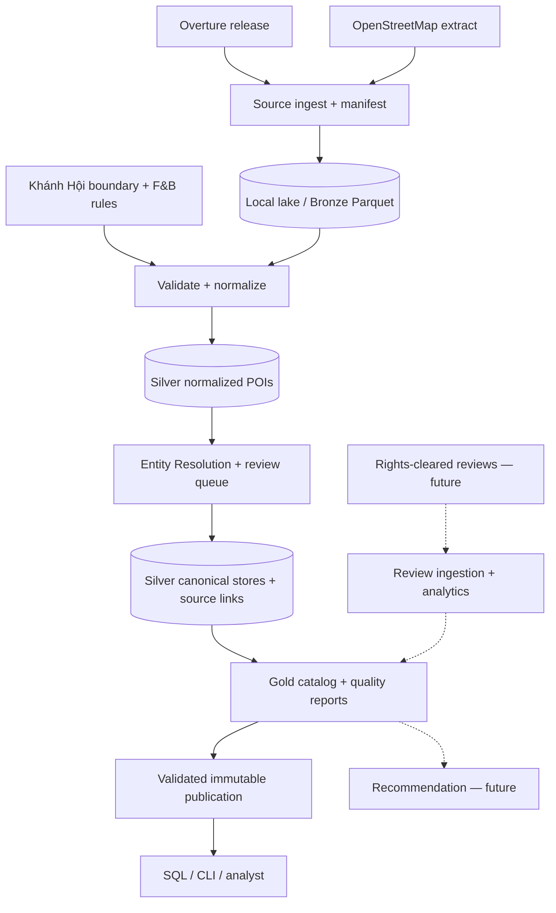

# 05 — System Architecture

**F&B Data Integration & Recommendation Platform**\
**Version:** 1.0 · **Status:** Proposed / Draft · **Scope:** MVP Khánh Hội, then Releases 2–3\
**Related:** `01_BRD.md`, `02_PRD.md`, `03_SRS.md`, `06_DATA_MODEL.md`, `07_PIPELINE_DESIGN.md`

## 1. Mục tiêu kiến trúc

Kiến trúc cần tạo danh mục địa điểm F&B hợp nhất từ **Overture Maps + OSM**, chạy được trên một máy, có đầu ra có thể tái lập, truy vết nguồn, kiểm tra chất lượng và công bố an toàn. Sau MVP, bổ sung cập nhật snapshot, reviews hợp lệ, analytics và recommendation mà không buộc thay lại toàn bộ dữ liệu.

**Quyết định cốt lõi:** local filesystem + Parquet; Python + DuckDB cho data processing; dbt-duckdb là lựa chọn triển khai transformations/tests sau khi kiểm tra tương thích code; không triển khai MinIO/Spark/Iceberg/Trino/Kafka/RabbitMQ theo mặc định.

## 2. Context và data flow

Luồng trên là **target design**, không phải khẳng định các bước đã tồn tại trong repository.

## 3. Các thành phần

| Component | Trách nhiệm | MVP / Sau |
|---|---|---|
| Source adapters | Nhận snapshot và metadata nguồn; cô lập thay đổi schema | MVP |
| Boundary/category mapping | Point-in-polygon, xác định F&B từng nguồn và lưu rule version | MVP |
| Bronze storage | Lưu raw snapshot/extract và ingestion manifests; không tự ghi đè | MVP |
| Normalization + ER | Chuẩn hóa, tạo candidate, match/non-match/review, tránh gộp nhầm | MVP |
| Canonical catalog | `store_id`, source links, giải thích field selection | MVP |
| Gold + query | Catalog khai thác, coverage/quality, SQL ví dụ | MVP |
| Publication controller | Kiểm tra gates; công bố version hoàn chỉnh, rollback pointer | MVP |
| Snapshot change detector | New/changed/missing-from-source, giữ lịch sử cần thiết | Release 2 |
| Review ingestion | Tái sử dụng crawler **chỉ sau khi audit và được phép** | Release 2 |
| Operational DB | PostgreSQL cho shared jobs/lease/attempts nếu có multi-worker | Release 2 khi cần |
| Orchestration | CLI trước, Airflow cho scheduling sau | Release 2 |
| Recommendation | Feature extraction, baseline/ranking/evaluation | Release 3 |

## 4. Tách data plane và control plane

- **Data plane:** Parquet trong `data/bronze`, `data/silver`, `data/gold`; DuckDB đọc/transform dữ liệu; các phiên bản publication bất biến.
- **Control plane MVP:** CLI/config/manifest/file-based approvals và một writer công bố; không cần service DB riêng.
- **Control plane tương lai:** PostgreSQL chứa job state, leases, attempts, checkpoints, publications khi nhiều worker/service cùng đọc ghi trạng thái. PostgreSQL **không thay Parquet/DuckDB**.
- **Airflow metadata DB:** riêng biệt với application operational tables khi Airflow được triển khai.

## 5. Runtime và deployment

- **Local:** Windows + Python/Conda hoặc WSL2; root của data lake nằm ngoài Git, có config đường dẫn; tránh chạy pip cài vào MSYS2 Python.
- **Docker sau này:** bind-mount **cùng dữ liệu local** vào worker/Airflow; kiểm tra permission, path và filesystem semantics; không cần MinIO.
- **GCP sau này:** nếu dữ liệu cần tồn tại độc lập VM hoặc có nhiều máy đọc, có thể đổi storage adapter sang GCS. Không cam kết migration trước khi thử.
- **Concurrency:** có thể song song hóa download/staging độc lập; chỉ một writer publish catalog/current pointer mỗi phiên bản.

## 6. Ranh giới chất lượng và an toàn

- Tất cả kết quả Gold chỉ từ input đã khóa phiên bản; lưu `run_id`, `source_version`, `rules_version`, `polygon_version`, `code_revision`, row counts và checksums trong manifest.
- `match`, `non_match`, `review` và mọi quyết định thủ công phải lưu bằng chứng, không được tự merge trường hợp mơ hồ.
- Dữ liệu nguồn chưa được xác minh hoặc chưa có quyền không đi vào data products dùng chung.
- Output chưa qua kiểm thử không được thay thế publication hiện hành.

## 7. Open decisions (không tự giả định)

1. Đường dẫn và API thật của code trong `crawl_experiment/`, `src/`, `pipelines/`, `scripts/` phải audit trước khi kết nối.
2. Polygon/OSM extract chính xác và Overture release phải chốt bằng manifest M1.
3. Dung lượng đầu vào, sơ đồ current publication và luật xử lý tie/cluster cần benchmark và test.
4. Airflow/PostgreSQL/monitoring server chưa phải thành phần chạy ở MVP.

**Acceptance:** có sơ đồ data flow khớp code, test idempotency/publication và một run thực Khánh Hội; mọi thành phần chưa chạy được ghi `PLANNED` thay vì `IMPLEMENTED`.
