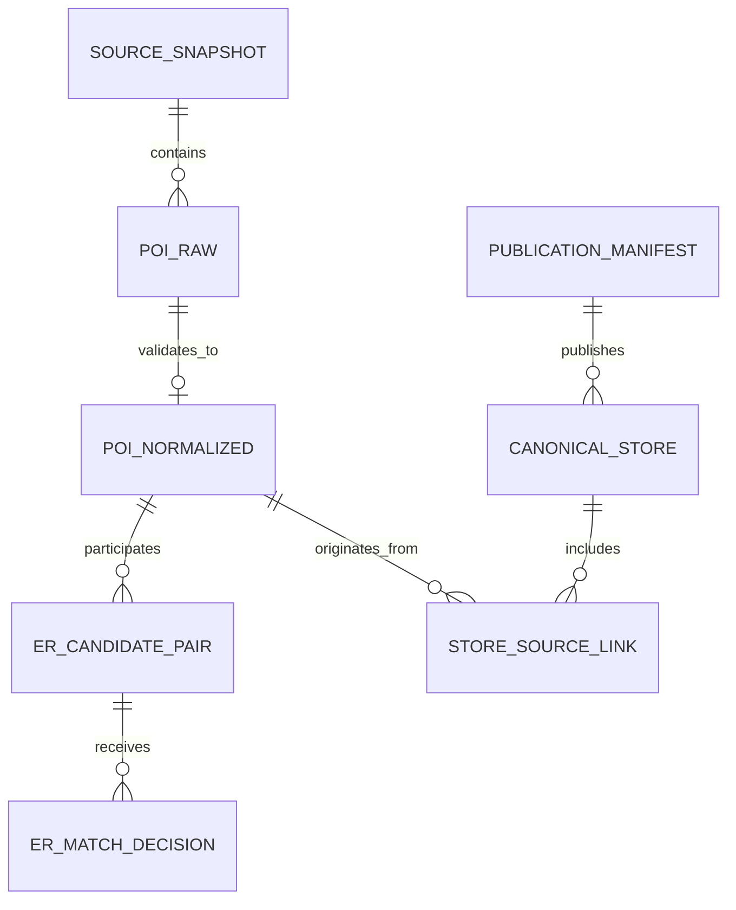

# 06 — Data Model & Contracts

**Version:** 1.0 · **Status:** Proposed; physical DDL chưa khóa · **Related:** `03_SRS.md`, `05_SYSTEM_ARCHITECTURE.md`

## 1. Nguyên tắc thiết kế

**Grain** phải xác định trước columns. `source record` khác `canonical store`; một `store_id` là **một chi nhánh vật lý**. Source ID chỉ duy nhất trong phạm vi source/record version. Không dùng `name` làm primary key. Không mặc định tất cả tables là star schema; modeling phù hợp mục đích query trước.

## 2. MVP logical entities

| Entity | Grain (1 row = ?) | Key đề xuất | Trường thiết yếu |
|---|---|---|---|
| `ingestion_run` | Một lần ingest nguồn | `run_id` | source, snapshot_id, row counts, code/config version, status |
| `source_snapshot` | Một snapshot/release nguồn | `(source, snapshot_id)` | uri, acquired_at, checksum, license status |
| `poi_raw` | Một record **trong snapshot** | `(source, snapshot_id, source_record_id)` | raw payload / file path, extracted_at, source metadata |
| `poi_normalized` | Một source record sau validation | cùng composite key | name_raw, name_norm, lat/lon, category_original, category_mapped, quality flags |
| `er_candidate_pair` | Một cặp POI có thể trùng trong ER run | `pair_id` | left_key/right_key canonical order, distance, similarities, blocker, rule version |
| `er_match_decision` | Một quyết định cho cặp + version | `decision_id` | pair_id, match/non_match/review, confidence, evidence, decided_by, decided_at |
| `canonical_store` | Một chi nhánh tại publication | `(publication_id, store_id)` | display_name, location, category, confidence/status, selected field lineage |
| `store_source_link` | Một link từ store → source record | `(publication_id, store_id, source, snapshot_id, source_record_id)` | decision evidence, first_seen |
| `review_queue` | Một cặp cần kiểm tra | `(er_run_id, pair_id)` | reason, priority, review status |
| `publication_manifest` | Một publication hoàn chỉnh | `publication_id` | inputs, rules, counts, quality gates, paths, checksum, status |

`pair_id` nên tính trên **hai composite record keys đã sắp xếp ổn định** cùng ER context; không phụ thuộc thứ tự dataframe. `store_id` không thay đổi khi rerun cùng input/rules/decisions. Từ snapshot khác, cần bảng mapping/merge history để tránh ID churn; chưa hứa ổn định tuyệt đối trước khi thiết kế thuật toán và kiểm thử.

## 3. Các quan hệ bắt buộc

Mỗi published `store_source_link` phải tham chiếu đúng source record. Một source record **không được liên kết tới hai active stores trong cùng publication**, trừ trường hợp dữ liệu nguồn biểu diễn nhiều chi nhánh và đã được tách có bằng chứng.

## 4. Bronze / Silver / Gold

| Layer | Dataset | Nội dung |
|---|---|---|
| Bronze | source extracts, raw POIs, manifests | Lossless trong phạm vi extract, metadata đầy đủ; append/versioned |
| Silver | normalized POIs, matched pairs, decisions, canonical stores, source links | Validated, typed, dedup theo khóa **và phiên bản**, giữ lineage |
| Gold | unified catalog, source overlap report, quality aggregates | Sẵn cho analyst/query; chỉ từ publication đã pass gates |

`data/` và `output/` có thể đang bị Git ignore: **không đưa dữ liệu thô/sensitive vào Git**. Dữ liệu phái sinh không tự coi là redistributable.

## 5. Lựa chọn field khi nguồn mâu thuẫn

Lưu `selected_value`, `selected_from_source`, `selection_rule_version` và reference source record; giữ các alternative values. Ví dụ chọn tên theo chất lượng/nguồn/độ mới **chỉ là rule proposal**, phải test với dữ liệu thật. Không dùng dữ liệu missing như bằng chứng phủ định.

## 6. Data contracts & quality tests

| Dataset | Gate tối thiểu | Ví dụ test |
|---|---|---|
| `poi_raw` | non-null source/snapshot/record_id; unique key trong snapshot | duplicate key, bad payload counters |
| `poi_normalized` | coordinate range, provenance, valid classification flags | lat/lon range; polygon rule; original retained |
| `er_candidate_pair` | ordered non-self pair; unique per ER run | left != right, pair uniqueness, deterministic rerun |
| `er_match_decision` | valid enum, reason/version | allowed values; manual decision precedence |
| `canonical_store` | unique `(publication,store_id)`; spatial validity | unique/not_null; no unintended cluster merge fixture |
| `store_source_link` | valid references, at least one source/store | referential-integrity anti-joins |
| `publication_manifest` | complete input checksum/versions and PASS gates | no incomplete current pointer |

**dbt:** dùng `source` declarations, staging, intermediate và marts nếu hợp với repo; tests `unique`, `not_null`, `relationships`, `accepted_values` và custom SQL. Chưa giả định package `dbt-duckdb` đã cài/đã chạy.

## 7. Dimensional modeling khi có reviews (Release 2+)

Không ép mọi dữ liệu nguồn sang star schema ở MVP. Khi có review analytics:

- `dim_store` — một record/chi nhánh ở snapshot hiện hành (SCD1 cho các field hiển thị nếu hợp lý); `dim_store_history` (SCD2) **chỉ khi** truy vấn historical attributes cần thiết.
- `dim_date` — một calendar date.
- `fact_review` — **một review observation logic được chọn làm current**, chỉ khi quyền lưu hợp lệ; khóa nguồn + review ID; `source_updated_at`, `collected_at`, link store.
- `fact_store_day_metrics` — **một store × một date × một metrics version**; số reviews, score features, coverage, uncertainty.
- `bridge_store_source` — nhiều source records tương ứng một canonical store, giữ source keys/versions.

Không trộn observation event (có thể nhiều lần crawl) với logical current review grain. Không tạo SCD2 chỉ để có keyword.

## 8. Schema evolution

Adapter nguồn phải khai báo `schema_version` + mapping có test. Overture phiên bản gần đây dùng `taxonomy` và `basic_category`, **không phụ thuộc cột cũ `categories`**. Unknown/removed fields cần log; critical schema mismatch phải fail có thông báo. Mọi migration cần `schema contract test` và rollback plan.

## 9. Open items

Chốt kiểu dữ liệu vật lý, đường dẫn, tên tables, `store_id` allocator, temporal history policy, output format sau khi audit repo và profile snapshot thật. Không xem bảng trong tài liệu này là đã tồn tại.
