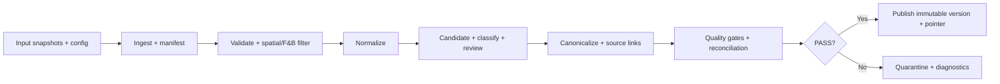

# 07 — Pipeline Design & Reliability

**Version:** 1.0 · **Status:** Proposed · **Related:** `03_SRS.md`, `05_SYSTEM_ARCHITECTURE.md`, `06_DATA_MODEL.md`

## 1. MVP batch pipeline



**MVP hoàn thành bằng CLI tuần tự.** Một task không được tự động chạy crawler live. Input snapshots và polygon phải khóa version; một lần chạy trả `run_id`, logs, manifest và success/failure status.

## 2. Kết cấu lưu trữ đề xuất

```text
data/
  bronze/{source}/{snapshot_id}/part-*.parquet
  silver/{run_id}/normalized/*.parquet
  silver/{run_id}/er/*.parquet
  gold/publications/{publication_id}/catalog/*.parquet
  gold/publications/{publication_id}/reports/*.parquet
  manifests/runs/{run_id}.json
  manifests/publications/{publication_id}.json
  manifests/current.json
output/
  benchmarks/
  quality/
```

Đây là **logical layout**, cần map với cấu trúc thật của repo; không ghi đè `data/` và `output/` hiện tại. Partition by source/snapshot/publication; chỉ thêm partition theo ward/date khi có query pattern và tránh quá nhiều small files.

## 3. Idempotency và replay

- Khóa dedup Bronze: `(source, snapshot_id, source_record_id)` ở cấp input version; raw observations có thể lặp qua snapshots.
- Tất cả transforms phải deterministic dưới input/rules/decision set khóa version; stable sorting/tie-breaking; timezone rõ ràng.
- Khi chạy lại cùng input, **không phát sinh thêm canonical stores/source links**. Byte-for-byte equality không bắt buộc nếu compression/metadata khác; so sánh logical result đã chuẩn hóa.
- Mọi bước có manifest, input/output counts và checksum (khi có thể); không dùng file existence đơn thuần làm bằng chứng đã hoàn tất.

## 4. Atomic publication & recovery

1. Viết vào `staging/<run_id>/` trên cùng filesystem.
2. Kiểm tra data contracts, duplicate/reference integrity, ER evaluation, báo cáo reconciliation; chỉ đánh PASS khi đạt các quality gates.
3. Đóng manifest đầy đủ và đảm bảo output đã được ghi thành công; chuyển thành `publications/<publication_id>/` bất biến.
4. Cập nhật **con trỏ `current.json` bằng thao tác replace atomic** trên cùng filesystem (theo API và OS đã test). Người đọc giải quyết pointer trước và chỉ đọc publication version được trỏ tới.
5. Nếu crash trước bước 4, publication cũ vẫn active; staging/orphan được reconcile sau. Nếu crash sau bước 4, manifest/data mới phải hoàn chỉnh.

Không giả định rename directory và file operations trên Windows/network filesystems luôn có semantics giống nhau; viết fault-injection tests trên môi trường triển khai. Không `rm -rf`/overwrite active publication trong cleanup.

## 5. Data quality & reconciliation

- Định nghĩa rõ mẫu số: `read = accepted + rejected + quarantined` nếu các trạng thái mutually exclusive; nếu filtered-by-boundary/category thì tách step counts để tránh cộng chồng.
- So sánh `source uniques`, `canonical stores`, `multi-source stores`, `review pairs`, `invalid coords`, `missing name` và unmatched.
- Query chính đọc Gold publication đã PASS, không đọc nửa pipeline.
- Negative examples: hai quán sát nhau, cùng thương hiệu khác chi nhánh, một tên nhiều ngôn ngữ, dữ liệu OSM thiếu tên, POI ngay mép polygon.

## 6. Incremental processing (Release 2)

Nguồn POI là **snapshot**, không phải CDC WAL. So sánh keys + normalized payload hashes giữa hai phiên bản để phân loại `new / changed / absent_in_new_snapshot`; `absent` **không có nghĩa `closed`**. Trường hợp đổi ID/merge/split phải có lineage và review, không tự động phá ổn định canonical ID. Có `backfill` từ historical snapshots và replay test.

## 7. Review ingestion (Release 2, có điều kiện)

Chỉ tích hợp crawler đã kiểm tra **source rights và operator restrictions**. Khi hợp lệ: external platform → crawler job state → append-only review observations → validated Silver current reviews → store join. Khóa dedup tại Silver là `(review_source, review_id)` (kèm source timestamp/version để chọn current); Bronze chấp nhận at-least-once. Không hứa bắt được mọi edit/delete từ platform.

Nếu nhiều workers, PostgreSQL có thể quản lý **lease/fencing token, attempts, checkpoint, DLQ, publication receipt**; ack sau publication; job claiming transactionally. Không tạo message broker hay queue service trước khi có yêu cầu vận hành thật.

## 8. Fault injection / mandatory tests

| Failure | Expected behavior |
|---|---|
| Raw input invalid | Quarantine + reason, không mất cả snapshot âm thầm |
| Một stage exception | Không thay `current.json`; log stage và run ID |
| Crash ngay trước publish pointer | Publication trước vẫn đọc được |
| Chạy lại cùng snapshot | Cùng logical store IDs và counts |
| Run đồng thời | Publication lock hoặc fail fast; không 2 writers ghi current |
| Review batch retry (future) | Bronze có thể lặp observation, Silver không nhân đôi logical review |

## 9. Acceptance

CLI chạy được trên fixture và snapshot thật, mỗi run sinh manifest, có `current` version hợp lệ, replay + fault-injection tests pass, báo cáo đầy đủ và không cần dùng live crawler. Performance numbers phải được đo ở `14_PERFORMANCE.md`.
