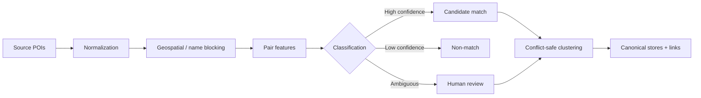

# 11 — Entity Resolution Design

**Version:** 1.0 · **Status:** Proposed; exact rules/thresholds are experimental · **Scope:** Overture ↔ OSM POI branches

## 1. Problem definition

One physical F&B branch can have multiple source records. Goal: assign one **canonical `store_id` per branch**, preserve original records and uncertainty. **False merge** (two branches collapsed) is often more damaging than holding uncertain pairs separately.

## 2. Stages

### A. Normalization

Keep raw and normalized versions for name, phone, address, coordinates and categories; unicode normalization/diacritics, abbreviations and punctuation handled by **versioned functions**. Address missing is `unknown`, not equal. Preserve lat/lon original, CRS and coordinate precision.

### B. Candidate generation / blocking

Use spatial blocking with geospatial tiles/grid/neighbor lookup; optionally name-token lookup for records with weak coordinates. Choose radius using evidence and category, not a single magic number. Log number of pairs before/after blocking; include difficult same-brand different-branch negatives.

### C. Pair features

`distance_m`, name similarity (token-based/RapidFuzz), token overlap, address agreement, phone/website exact match where available, category compatibility, source reference relationships, branch/address mismatch flags. Maintain feature completeness flags; do not interpret missing phone as mismatch.

### D. Decision

Rule-versioned classification `match | non_match | review`. Auto-match only with safe evidence; auto-non-match when strong negatives; ambiguous pairs to review. Store features, scores/threshold version, reason and manual override provenance. **Manual decisions take precedence** under a clear policy and need audit.

## 3. Clustering safeguards

Pair-wise A=B and B=C does **not** automatically mean A=C if C conflicts with A. Before unioning clusters, check:

- Known non-match constraints between members.
- No impossible same-source conflicting branch links unless explicitly allowed.
- Spatial spread/address/phone conflicts and same-brand branch indicators.
- Stable deterministic ordering and reproducible conflict handling.

Do not use naive connected components without conflict checks. If cluster uncertain, keep groups separate and add review cases; record reason.

## 4. Stable identity

MVP: deterministic canonical ID per fixed snapshot/rules/decisions using stable canonical seed/link choice (exact algorithm to be implemented/tested). Release 2: maintain `store_identity_registry` or persisted mapping to preserve IDs across snapshot changes; record merge/split events explicitly, avoid silent key reuse. A hash of normalized name alone is forbidden.

## 5. Evaluation design

- Create human-labeled **match and non-match** pairs, including hard negatives (nearby, same chain, same category) and hard positives (name variation/abbreviations).
- Separate tuning vs held-out evaluation; prevent same branch leaking across splits where feasible.
- Report precision, recall, F1, TP/FP/FN/TN and absolute error examples.
- Report **candidate recall** separately from classifier metrics on generated pairs; track review queue rate and false merge severity.
- Thresholds and target percentages remain **TBD until pilot labels/baseline**. Don't declare success solely from a single hand-selected example.

## 6. Data quality checks

1. No self-pairs, duplicate unordered pairs or invalid enum.
2. Source links refer to existing records; no linked record in two stores in same publication without exception reason.
3. No cluster violates known non-match constraints.
4. Each store has at least one source record and field provenance.
5. Rerun with shuffled input order yields same logical IDs and decisions.
6. Manual decisions survive rerun and cannot be silently overwritten.

## 7. Outputs and review workflow

`er_candidate_pair`, `er_match_decision`, `review_queue`, `canonical_store`, `store_source_link` and metric report. MVP review via CSV/CLI approved decisions file; no web dashboard required. Every decision records `decision_source`, `decided_at`, `reason`, `rules_version`.

## 8. Non-goals

No perfect market coverage inference, no guarantee source IDs never change, no cross-platform personal identity matching, no automatic merge of all review platform references. Source consent and rights are separate gate.
