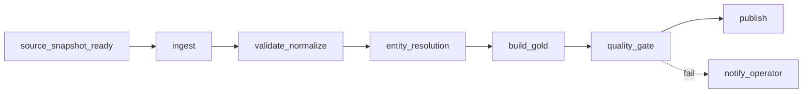

# 12 — Orchestration & Operations

**Version:** 1.0 · **Status:** M0/MVP CLI-first; production scheduler future

## 1. Principle

A pipeline must first be **repeatable and callable as a CLI**. Airflow coordinates tasks only after each task is independently reliable. Orchestrator != processing engine. Avoid one Airflow task per POI or review.

## 2. Proposed job interface

```text
fnb ingest --source overture --snapshot <id> --config <path>
fnb ingest --source osm --snapshot <id> --config <path>
fnb build-catalog --input-manifest <path> --dry-run
fnb evaluate-er --labels <path> --run-id <id>
fnb publish --run-id <id>
fnb status --run-id <id>
```

**Illustrative CLI only; commands not yet implemented.** Must map to `pyproject.toml` entrypoints if any exist after M0 audit. Commands accept external configuration, dry-run for risky changes, and emit structured machine-readable exit status.

## 3. Future Airflow DAG design



- DAG triggers on explicit snapshots / scheduled checks; execution uses immutable `run_id`, `source_snapshot_id`, config/rule versions.
- Task boundaries are coarse enough to log and retry but not thousands of tasks.
- Idempotency: each retry writes staging in isolated run/attempt context and checks manifests before publish.
- Use logical data intervals only when data semantics require; **snapshot version is source of truth**, not wall clock.
- Data passed between Airflow tasks as path/manifest ID, not large Parquet frames via XCom.

## 4. Review ingestion worker control plane (future)

If crawler service grows beyond one process: PostgreSQL tables `crawl_job`, `job_attempt`, `job_lease`, `checkpoint`, `publication_receipt`, `dead_letter`. Claim with row locking/`SKIP LOCKED` or equivalent transaction, lease renewal, fencing generation to reject stale writers, retry policy, terminal states and manual gate. Operator approval is required before using live platforms with prior restrictions.

Single host + low concurrency can retain existing SQLite-based legacy worker state **without network-sharing the DB file**; migration to PostgreSQL is not an MVP prerequisite.

## 5. Scheduling/retry policy

| Failure category | Action |
|---|---|
| Transient network timeout to allowed source | bounded retry with exponential backoff/jitter, idempotent attempt |
| Invalid schema/data contract | fail fast + quarantine/report, do not blind retry |
| License/access disallowed or policy restriction | stop; do not bypass with new identity/VM |
| Corrupt state or publication inconsistency | stop publish, manual reconciliation |
| Performance resource exhaustion | lower concurrency/partition size and capture profile |

## 6. Runbook: safe replay

1. Read `manifests/current.json` and latest run status.
2. Check source snapshot hashes, boundary/rules versions and execution environment.
3. Verify no active conflicting writer; **do not clear leases/reset DB blindly**.
4. Rerun the CLI with same immutable inputs into a new attempt/staging path.
5. Execute quality and reconciliation checks, verify publication and update status.
6. Preserve error artifacts; log cause and fix in incident note/ADR.

## 7. Deployment plan

Local: Conda venv or WSL2 plus filesystem. Docker Compose is optional after local tests; bind mounts for data lake, persistent volumes for operational DB. GCP VM/GCS later with cost cap and explicit approval; keep credentials out of repository.

## 8. Definition of operational readiness

Document CLI usage, recovery procedure, backup/restore dry run, alerts that trigger on actionable failures, owner of each runbook step, and observed runtime budgets. No claim of HA/distributed scalability from Docker alone.
