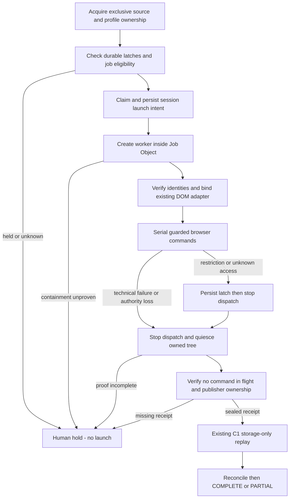

# M3-C2 — Process/session supervision safety decision

Ngày: 2026-10-21. **DESIGN GATE / BLOCKED — chưa hoàn thành M3-C2.**

Không triển khai supervisor hoặc restriction latch khi containment contract chưa
được chốt. Dừng theo yêu cầu: “Nếu phát hiện điểm không thể triển khai an toàn với
Windows/process/browser architecture hiện tại, dừng ở design decision”. Đây không
phải kết luận Windows không hỗ trợ; API hiện hữu chưa cung cấp đủ bằng chứng để
cấp automatic quiescence/takeover. Không sửa M1–C1 hoặc nới invariants để đi tiếp.

Baseline đã đọc: [M3-A](global_crawler_harness_m3a_assessment.md),
[M3-B](global_crawler_harness_m3b_implementation.md),
[M3-C1](global_crawler_harness_m3c1_publication.md), current task, agent rules và
Google frozen registry/manifest/runbook. Git status kiểm tra trước thao tác;
uncommitted/untracked source và historical outputs giữ nguyên.

## 1. Findings trực tiếp từ code

| ID / severity | Reference, trigger | Safety gap và hậu quả | Thay đổi cần duyệt |
|---|---|---|---|
| C2-01 Critical | [factory](../../experiments/tiktok_access_benchmark/session_manager.py#L50), [DOM constructor](../../experiments/tiktok_comment_dom/probe.py#L377), [external attach](../../experiments/tiktok_access_benchmark/existing_session.py#L9) | Driver được tạo trước khi có harness containment hoặc được inject từ process khác. Driver/session ID không chứng minh worker/Chrome/ChromeDriver descendants thuộc supervisor. Không thể an toàn adopt tùy ý một authenticated browser đang mở. | Managed-only launch contract; không tự adopt legacy/user Chrome; tạo worker trong Job Object từ lúc process birth. |
| C2-02 Critical | [navigate/snapshot](../../experiments/tiktok_comment_dom/probe.py#L394), [runner direct access](../../experiments/tiktok_place_intelligence/probe.py#L528), [finally screenshot](../../experiments/tiktok_place_intelligence/probe.py#L569) | Port chưa kiểm tra Claim/session. Wrapper chỉ quanh navigate/click không bao phủ `port.driver`, network capture, screenshots, WebElement methods hoặc finally. Action sau expiry/takeover vẫn có thể dispatch dù SQLite từ chối commit. | Một command boundary thực sự, không expose raw driver; inventory mọi driver use và test in-flight/finally. Tránh sửa collector bằng một wrapper chỉ trông có vẻ fenced. |
| C2-03 High | [lifecycle close](../../crawl_experiment/browser/seleniumbase_session.py#L66), installed SeleniumBase 4.54.11 `undetected/__init__.py:275–309,414–430,598–604` | UC lưu browser PID/create-time và có `is_running()` kiểm tra PID reuse, nhưng đường `quit()` được audit gọi `os.kill(browser_pid,15)`. Existing lifecycle gọi driver.quit; không có harness ownership proof hoặc descendant join. Không được xem PID/process-name cleanup là safe supervisor cleanup. | Containment-owned process handles/Job Object; không patch frozen shared lifecycle hoặc installed package. Managed cleanup phải có exact identity và không dựa vào raw driver.quit để chứng minh tree đã dừng. |
| C2-04 High | [takeover](../../crawler_harness/state.py#L328), [publisher](../../crawler_harness/publication.py#L125) | Quiescence vẫn là trusted callback. C1 mutex loại concurrent publishers nhưng abandoned mutex không chứng minh browser/source process chết. | Strong quiescence verifier giữ exclusive ownership, exact old session/attempt identity, tree exit, no in-flight command và C1 publisher locks. |
| C2-05 High | [adapter outcomes](../../crawler_harness/tiktok_adapter.py#L115), [claim](../../crawler_harness/state.py#L299) | Restriction là job state, chưa source/session latch. A ACCESS_RESTRICTED vẫn không ngăn B PENDING được claim qua generic M1 API. | Durable source/session latch + atomic supervised dispatch check. Không thay M1 generic claim thành source scheduler lén lút. |
| C2-06 High | [receipt sealing](../../crawler_harness/tiktok_adapter.py#L96), [resume](../../experiments/tiktok_place_intelligence/probe.py#L461) | Worker chết giữa video có thể chỉ để lại intermediate checkpoint. `resume=True` yêu cầu existing matching browser; không phải authorization recollect sau process restart. | Missing-receipt policy giữ human hold; storage-only replay chỉ khi có seal/receipt hợp lệ. Không fabricate PARTIAL/COMPLETE observation từ count. |

Đây là gaps C2 đã được khai báo từ M3-A/B/C1, không phải bằng chứng M1 source fencing
hoặc C1 recovery bị regression. M3-B hiện vẫn chỉ nhận fake fixture ports; gate này
được giữ nguyên. Không bật managed live bằng cách đặt fixture flag lên real port.

## 2. Offline evidence thực chạy

Script: [audit_probes.py](../../output/m3c2-safety-audit-20261021/audit_probes.py).
Results: [audit_results.json](../../output/m3c2-safety-audit-20261021/audit_results.json).
Source hashes trước audit: [source_before.json](../../output/m3c2-safety-audit-20261021/source_before.json).

- Expired control token bị từ chối; fake DOM port vẫn thực hiện fake navigation.
- Sau takeover với **fault-injected attestation**, old port vẫn thực hiện fake
  navigation; old source commit bị M3-B guard từ chối. Callback True trong probe
  không phải process-death proof và không được dùng trong production.
- AUTH_GATE làm A ACCESS_RESTRICTED, state tồn tại sau reopen; B cùng source vẫn
  claim được. Committed fixture có 1 SQLite comment/1 event, không publication.
- Real Python worker `os._exit(81)` để lại Python descendant còn sống. Đây là
  ordinary subprocess fixture, **không phải Chrome/UC containment test**. Cleanup
  mở process handle, đối chiếu exact creation FILETIME rồi terminate/join trên
  chính handle đó; không kill theo process-name hoặc PID lookup không kiểm chứng.
  Child có self-exit deadline, không đụng process người dùng.
- Windows CreateJobObject/SetInformationJobObject cho phép cấu hình
  KILL_ON_JOB_CLOSE trên máy này. Không assign process trong capability probe:
  kết quả này **không chứng minh** worker/browser containment.
- 10 audited source hashes không đổi; không real browser, source network hoặc
  third-party provider calls. Initial probe thiếu snapshot URL đã lỗi ValueError;
  sửa fixture, chạy lại trên isolated DB mới rồi pass; không sửa source để che lỗi.

Đây là một audit script có assertions, không phải acceptance suite M3-C2 hoàn tất.
Giữ cả failed fixture và successful fixture, không xóa hoặc overwrite DB cũ.

```powershell
Set-Location '<repository-root>'
& 'python' -B output/m3c2-safety-audit-20261021/audit_probes.py
```

Script tạo fixture directory mới mỗi lần, tự cleanup verified child; không crawl.
`audit_results.json` là latest audit summary; fixture directories vẫn giữ nguyên.

## 3. Design decision cần review

Đề xuất **managed-only contained worker**, giữ nguyên legacy CLI ngoài managed
guarantees. Không chọn phương án attach arbitrary existing browser.

| Phương án | Ưu điểm | Trade-off / quyết định |
|---|---|---|
| Contained worker tạo browser qua existing factory | Giữ collector/UC, có kernel ownership boundary từ process birth | Cần launcher riêng của harness, dedicated profile ownership và durable session registry. Đề xuất chọn. |
| Adopt browser/profile đang mở từ legacy/user session | Ít thay workflow hiện tại | Không chứng minh ancestry/commands khác/ownership; NO-GO managed. Không kill hoặc chuyển quyền tự động. |
| PID/process-name enumeration rồi kill tree | Dễ viết | PID reuse, detached descendants và race; bác bỏ. |
| Guard token trước/sau mỗi port method, không containment | Ít code | Không dừng command đã dispatch; direct driver/finally bypass; bác bỏ như safety guarantee. |

Managed v1 chỉ launch worker qua supervisor, reuse factory và `run_dom_comments`
trong worker. Profile mới hoặc **dedicated harness-owned persistent profile đã đóng
và được lock độc quyền**; không tự nhận profile của Chrome đang mở. Session UUID
của harness, WebDriver session ID, Windows session ID và attempt ID là bốn identity
khác nhau; không dùng thay thế cho nhau.

### Windows launch contract

- Job Object không cho breakaway, handle không inherit, KILL_ON_JOB_CLOSE.
- Process membership phải thiết lập tại creation bằng Windows job-list process
  attribute hoặc cơ chế tương đương đã chứng minh. `Popen` rồi assign là quá muộn.
  Suspended-create rồi assign vẫn có controller-crash window trước assignment;
  không tự hạ xuống fallback này rồi claim an toàn.
- Store process handle + PID + creation FILETIME + Windows session ID + immutable
  harness session/job/attempt identity. Track/query Job Object descendants; không
  assume parent exited nghĩa child exited.
- Nếu API/nested-job restrictions/permissions không cho containment, launch bị
  từ chối trước browser. Không bật breakaway để làm Chrome chạy được.

Microsoft mô tả descendant Job Object membership và kill-on-last-handle behavior
trong [Job Objects](https://learn.microsoft.com/en-us/windows/win32/procthread/job-objects).
Atomic membership tại process birth tránh suspended-create/assign crash window;
xem [Windows job-list process attribute](https://devblogs.microsoft.com/oldnewthing/20230209-00/?p=107812).
Đây là design dựa trên API docs, chưa phải implementation đã test trong repo.

### Durable storage contract — chưa áp dụng migration

Đề xuất optional extension version riêng, giữ nguyên M1 states và source/outbox/
receipt/Parquet schema. Cần review DDL, validator compatibility, backup và rollback
trước implementation. Không dùng raw browser text hoặc cookie làm session key.

Logical records tối thiểu:

- Session registry: session UUID, source/scope/profile identity, job/attempt/
  generation, controller/worker creation identities, Job Object identity,
  lifecycle, current command ID/status, quiescence evidence reference.
- Restriction latch: source/session scope, epoch/version, active reason,
  observed time, not-before UTC, endpoint category, evidence reference,
  explicit release actor/evidence/verification. Append history giữ mọi set/release.
- Existing harness history dùng cho job-correlated events. Không chèn registry
  vào event `code` JSON tùy tiện rồi coi đó là reviewed schema contract.

M1 validator hiện chỉ chấp nhận exact known tables/DDL. Không thêm tables bên ngoài
validator hoặc bỏ drift check. Proposed optional extension chưa có migration file,
chưa được áp dụng lên cả test DB lẫn runtime DB.

Backup/rollback đề xuất: ngừng dispatch, establish quiescence, SQLite backup API
và preserve lake; install extension trên bản sao + reopen tests trước. Rollback
disable supervisor dispatch, giữ latches/registry/evidence nguyên trạng, không
drop/xóa metadata hoặc dùng old binary dispatch vào managed DB. Compatibility
cho old reader cần explicit validator update; không claim tự backward compatible.

## 4. Lifecycle và command protocol đề xuất



Supervisor/source ownership mutex spans managed session lifetime. Dispatches are
sequential. Separate heartbeat connection belongs to its thread, bounded updates,
stop/join on shutdown; không share SQLite connection qua threads.

Command protocol: short authority/session/latch transaction → durable command
intent → browser dispatch outside SQL write lock → command return + authority/
identity/latch recheck. No caller receives success if postcheck fails. Một command
đã dispatch không rollback được; exclusive lifecycle ownership và process-tree
quiescence mới ngăn owner mới hành động đồng thời.

Mọi driver surface cần đi qua cùng guard, gồm properties, execute/CDP/logging,
WebElements và screenshots/finally. Không expose unguarded raw driver từ port.
Timeout không tự chứng minh command đã dừng. Command UNKNOWN vẫn hold cho đến
khi owned worker/browser tree được join hoặc bị terminate an toàn và verified.

Mất lease chỉ dừng dispatch. Cleanup chỉ tác động exact retained handles/Job Object
của session cũ đã bind; không gọi broad Chrome cleanup. Không kéo dài lease đã hết.
Live actor mới chỉ được tạo sau quiescence và valid M1 ownership transition.

## 5. Quiescence/takeover contract đề xuất

Verifier phải trả structured facts đã bind exact old job/attempt/generation/session,
không nhận caller-supplied boolean làm proof tự động:

1. Stop dispatch, hold exclusive source/profile lifecycle ownership.
2. Old worker handle signaled; verify creation identity, không PID-only.
3. Owned Job Object descendants đã exit, gồm browser/driver/helper/publisher
   được quản lý. Join deadline hữu hạn; không đủ evidence thì human hold.
4. No browser command in flight. Crash trong command được resolve bằng verified
   tree quiescence, không tự replay click/scroll/reply expansion.
5. Acquire cả DB/lake C1 mutexes; publisher I/O còn giữ quyền thì từ chối takeover.
6. Validate durable old session record và expected generation, lưu certificate/
   evidence ref. M1 takeover vẫn atomic, chỉ cho expired active job, không reopen
   terminal/restricted job. Hai contenders phải serialize bằng cùng lifecycle
   ownership và expected-generation CAS.

Controller chết/lost handles: KILL_ON_JOB_CLOSE hữu ích nhưng không dùng absence
của named Job Object hoặc abandoned mutex làm complete proof. Nếu không khôi phục
được verified identities/descendant exit, durable session UNKNOWN và human hold.
Repeated restart không tự cấp session hoặc recollect.

## 6. Durable restrictions và operator release đề xuất

- CAPTCHA, active login gate, required denial, HTTP 429: latch affected session và
  mặc định source cho single-session v1; chặn launch/dispatch job tiếp theo.
- Unknown access/unknown 403: latch UNKNOWN, không suy clear. Optional-resource
  403 chỉ telemetry theo existing classifier, không biến thành required denial.
- Persist latch trước khi nhả lifecycle ownership. Nếu SQLite không ghi được latch,
  không tiếp tục dispatch; recovery phải coi session chưa cleanly closed là UNKNOWN.
- Retry-After lưu not-before hợp lệ; hết giờ vẫn chưa tự clear. Không restart
  browser để né gate, không giải CAPTCHA.
- Release là explicit operator operation: exact latch epoch, actor/evidence,
  fresh verification đúng source/session, no active challenge/denial, not-before
  đã qua, quiescence/ownership verified. Missing/stale/wrong-scope verification
  hoặc changed latch epoch đều từ chối. Không accept arbitrary `verified=True`.
- Release chỉ thay latch + append audit atomically; không đổi terminal job state,
  receipt source coverage hoặc cấp Claim. Restricted job cũ vẫn held. New eligible
  job cần normal scheduler/claim contract; không tạo refresh epoch để tự retry.

Operator live verification flow chưa triển khai và không thực hiện trong task này.
Phiên bản offline sau review chỉ dùng verification fixture do trusted verifier
phát hành, không coi một CLI flag là bằng chứng xác minh.

## 7. Recovery boundaries và acceptance matrix

Không có automatic browser retry trong trạng thái hiện tại. Đề xuất chỉ bounded
technical retry sau proven quiescence, explicit budget và đủ identity/checkpoint
proof. Restart browser và recollect là hai quyết định khác nhau. Với sealed receipt,
chỉ gọi C1, không gọi lại collector. Giữ data_run_id, receipt provenance và unique
per-attempt evidence. Source-ID refresh/SESSION_FALLBACK limitations không đổi.

| Required C2 test | Hiện đã có gì | Acceptance còn phải implement/test |
|---|---|---|
| Worker chết giữa video | Audit orphan-process fixture | Real contained tree zero, committed data giữ nguyên; missing seal held |
| Browser chết/worker sống | Chưa C2 test | Verified browser handle death, stop worker dispatch, no recollect |
| Lease mất/browser sống; stale worker actions | Fake-port probe xác nhận gap | New guarded port refuses commands; takeover chưa được phép khi tree sống |
| Lease expiry/old process vẫn sống | M1 refuses implicit takeover | C2 process-aware verifier refuses, không dựa boolean |
| Publisher I/O chưa xong | C1 real publisher contention pass | C2 takeover refuses while C1 locks owned |
| Hai takeover contenders | M1 generation/transaction tests | C2 lifecycle mutex + identity certificate race tests |
| Session/browser/attempt mismatch | Chưa C2 test | Pre/post/action cleanup fail-closed, unrelated process untouched |
| CAPTCHA/login/429 survive restart | Job-level AUTH_GATE probe only | Durable source/session latches for every reason + Retry-After |
| Missing verification/UNKNOWN release | Chưa C2 implementation | Wrong epoch/scope/stale verification denied, no automatic resume |
| Storage replay/no collector | C1 process fault/replay pass | C2 routes sealed crash directly into C1 with collector call-count zero |
| Repeated restart/no duplicate effects | C1 repeats storage audits pass | C2 interrupted command/session UNKNOWN never redispatched automatically |
| Heartbeat independent DB/no lock over wait | M1 source transactions tested | Separate thread connection; other connection writes during fake wait; expired heartbeat stops dispatch |
| Controller death before/after launch | Chưa C2 test | Atomic Job Object assignment, no runnable orphan; verify fail-closed restart |

Không đánh dấu các ô chưa triển khai là passed chỉ vì regression cũ xanh.

## 8. Fresh regression và changed files

**349 passed, 2 warnings, 50.78s, zero skipped** trên Windows MSI. Không dùng lại
50.88s của milestone C1. Suites: M1/M2/M3-B/C1, DOM/replies, legacy persistence,
compaction, live-DOM integration fixtures, Overture/reliability và Google baseline.
Warnings Pandas numexpr/bottleneck có sẵn; không đổi dependencies.

```powershell
$testRoot = 'output/t' + [guid]::NewGuid().ToString('N').Substring(0,5)
& 'python' -B -m pytest -q --import-mode=importlib -p no:cacheprovider --basetemp $testRoot `
  tests/test_harness_publication.py tests/test_harness_tiktok_managed.py `
  tests/test_harness_state.py tests/test_harness_hardening.py tests/test_harness_recovery.py `
  experiments/tiktok_comment_dom/test_dom.py experiments/tiktok_comment_dom/test_replies_scroll.py `
  experiments/tiktok_comment_dom/test_persistence.py experiments/tiktok_comment_dom/test_compaction.py `
  experiments/tiktok_place_intelligence/test_live_dom_persistence.py `
  experiments/tiktok_access_benchmark/test_overture_study.py `
  experiments/tiktok_access_benchmark/test_reliability.py tests/test_google_baseline.py
```

Raw regression fixtures: `output/tfaf0d/`. Audit script/results chỉ dưới isolated
`output/m3c2-safety-audit-20261021/`; không publish runtime evidence lên Git.
Repo deliverables thay đổi: báo cáo này, current_task.md và work_status.md, thêm
checkpoint. **Không production/harness/collector source changes, không migration,
không supervisor hoặc release command đã hoạt động.**

## 9. Readiness và bước tiếp theo

**M3-D NO-GO. M3-C2 chưa đạt acceptance.** Blocker là thiếu reviewed launch/
ownership boundary và durable session/restriction contract, không phải thiếu AI.

Đề xuất review ba quyết định trước code:

1. Managed sessions chỉ được launch trong Job Object từ process birth; không
   adopt existing/attached Chrome. Persistent profile chỉ khi dedicated và owned.
2. Duyệt optional session/latch schema và compatibility/backup/rollback plan;
   giữ nguyên generic M1 state machine, không silently upgrade runtime DB.
3. Guard toàn bộ command surface, kể cả raw-driver/finally paths, với minimal
   integration hooks được test; không patch frozen shared modules/dependencies.

Sau review: implement containment + process fault tests trước; rồi command guard/
heartbeat; cuối cùng durable latch/operator release và C1 routing end-to-end.
Không chuyển M3-D/live nếu các tests C2 trên chưa có evidence thực chạy.
