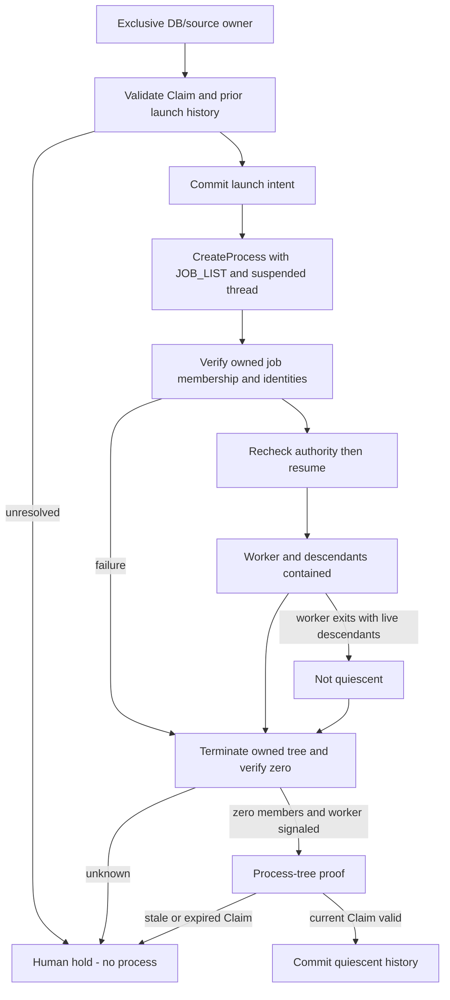

# M3-C2a — Windows managed worker containment

Ngày: 2026-10-21. Phạm vi: **OFFLINE Python workers, không browser thật**.
Trạng thái: **IMPLEMENTED / offline verified — STOP để review**.
Baseline: [C2 safety decision](global_crawler_harness_m3c2_supervision.md),
[M3-B source fencing](global_crawler_harness_m3b_implementation.md),
[M3-C1 publication](global_crawler_harness_m3c1_publication.md).

## 1. Implementation và phạm vi

Thêm [containment.py](../../crawler_harness/containment.py) và
[test_harness_containment.py](../../tests/test_harness_containment.py). Không sửa
collector, existing launcher/browser backend, M1/M2/B/C1 source, dependencies,
Google frozen baseline hoặc SQLite/Parquet schema. Chỉ thêm control-history facts
bằng existing fenced JobStore transaction; không tạo session/restriction tables.

`ManagedWorker(store, claim)` là managed-only launcher: chỉ khởi tạo **process
Python mới** dùng executable của interpreter hiện tại, explicit argv và không shell.
Không API adopt PID, attach WebDriver, import cookies hoặc nhận Chrome/profile bên
ngoài. Caller là trusted harness code; đây không phải security sandbox cho code lạ.
Không tự claim, takeover, heartbeat, restart/retry, collect hoặc release restriction.

### Atomic containment tại process creation

1. Acquire Windows Global source-owner mutex theo physical database identity;
   reuse C1 `resource_id`/`windows_mutex`, không tạo lock implementation cạnh tranh.
   Cùng DB qua hardlink alias vẫn tranh quyền; same-thread reentrant owner bị chặn.
2. Validate current M1 Claim và RUNNING TikTok collection job; kiểm tra unresolved
   launch intents và cấm launch lại cùng attempt.
3. Tạo unnamed Job Object với **KILL_ON_JOB_CLOSE**, không breakaway flags. Controller
   giữ sole private job handle; kiểm tra ownership handles không inheritable.
4. Ghi `worker.launch_intent` + session UUID bằng existing owned transaction trước
   native create. Đây là process launch fact, không source access restriction latch.
5. `STARTUPINFOEX` + `PROC_THREAD_ATTRIBUTE_JOB_LIST` đưa worker vào owned Job Object
   **ngay trong CreateProcessW**. Không gọi AssignProcessToJobObject sau creation.
   CREATE_SUSPENDED chỉ để kiểm chứng trước execution, không phải fallback assign.
6. Verify IsProcessInJob trên exact returned handle, process creation FILETIME,
   PID, Windows session ID và noninherit flags; recheck current authority/RUNNING
   trước ResumeThread và original lease trước transaction commit.
7. Worker chạy; process descendants thông thường kế thừa containment. Không bật
   BREAKAWAY_OK/SILENT_BREAKAWAY_OK khi API hoặc nested-job constraints không phù hợp.

Windows hỗ trợ job-list process attribute từ Windows 10/Server 2016. Không có API
hoặc lỗi permission/configuration thì fail-closed, không chuyển sang Popen/assign
hay PID-based cleanup. Xem [Microsoft UpdateProcThreadAttribute](https://learn.microsoft.com/en-us/windows/win32/api/processthreadsapi/nf-processthreadsapi-updateprocthreadattribute).

## 2. Ownership và quiescence

Binding gồm job/attempt/generation, random harness session UUID, physical database
identity, supervisor PID/creation FILETIME/Windows session ID và worker identity.
Không lưu command line, credentials, environment hoặc browser data vào history.
Kernel handles thuộc supervisor process và thread tạo owner; thread/process khác,
wrong session/attempt hoặc changed database resource bị từ chối.

`inventory()` query kernel Job Object membership, mở query/synchronize handles cho
members rồi verify explicit owned-job membership và creation identities. Không
adopt process ngoài job khi inventory trả PID lạ. Giữ handles cho đến close. Nếu
inventory race với process exit hoặc không query được, fail observation/hold;
không suy quiescence từ danh sách PID rỗng.

`shutdown(session_id=..., attempt_id=..., timeout=...)` chỉ terminate **owned Job
Object handle**, sau đó bounded native observation xác nhận ActiveProcesses=0 và
worker handle signaled. Không kill theo PID/name, không đóng browser của người dùng.
Deadline 0..30 giây, mặc định 5; không source retry/backoff loop. Nếu không xác
nhận được, không trả quiescence proof; cuối cùng close handle kill-on-close là
fail-safe, không phải proof rằng asynchronous termination đã hoàn tất.

`quiescence()` trả scope **OWNED_PROCESS_TREE_ONLY**. Không tự tạo M1 takeover
permission, không chứng minh browser command boundary/profile ownership, không
chứng minh external publisher đã dừng. C1 DB/lake publication locks vẫn độc lập.
Full-source verifier còn thuộc C2b, phải giữ cả ownership và C1 locks khi quyết định.



## 3. Crash/restart và durable intent contract

Existing `harness_events` nhận ba additive event types:

- `worker.launch_intent`: random session UUID, existing job/run/attempt/generation.
- `worker.quiescent`: chỉ sau retained worker handle signaled và kernel job zero.
- `worker.launch_aborted`: verified no completed worker creation và empty owned job.

Scope/source selection và intent resolution chạy trong M1 transaction. Không thêm
states/tables/version, không đặt registry JSON vào event `code`. Existing `_event`
ghi đầy đủ correlation. C1 event routing chỉ đọc source.event_committed nên không
nhầm process-history UUID với source event ID.

Normal close dùng current valid Claim để append resolution. Nếu lease đã hết hoặc
owner/generation thay đổi, vẫn được cleanup **chính retained kernel tree** của
supervisor/session này; không được ghi stale job state, source data hoặc resolution.
Proof có `durable_resolution=False`, unresolved intent tiếp tục giữ gate.

Supervisor crash tự đóng noninheritable job handle; kernel kill-on-close xử lý tree.
**Restart không dùng abandoned mutex hoặc PID absence làm death proof.** Launch
intent chưa resolved chặn mọi managed launch cùng source trong DB, kể cả job/attempt
khác. Hai repeated restarts không tạo intent/process mới. Không auto-clear history,
adopt orphan hay tự cấp Claim mới. Lost controller handles cần reviewed human
resolution flow ở milestone sau; C2a không cung cấp unsafe repair command.

Sau clean close, cùng attempt vẫn không được launch lại; job khác eligible có thể
launch sau khi source ownership được nhả. Không tuyên bố exactly-once source crawl.

## 4. Reuse và storage safety

- M1 quản lý Claim/generation/attempt và atomic history writes; launcher không thay
  generic claim/takeover semantics. Native creation/pre-resume checks nằm trong
  short ledger transactions, không giữ SQL write lock trong worker waits/shutdown.
- M3-B source connection guard/receipt seal giữ nguyên. Worker chết không xóa source
  rows, events hoặc checkpoints. C2a không reconstruct missing receipt.
- M3-C1 vẫn là đường publication/recovery duy nhất. Fixture worker commit bằng
  existing managed adapter/writer rồi exit81; parent verify quiescence, close owner
  và gọi **existing JobScopedPublication** storage-only. Không gọi collector.
- Fixture kết thúc PARTIAL vì MAX_SCROLLS: 1 SQLite comment, 1 event, 1 Parquet row,
  pending=0. Hai repeated audits giữ nguyên file bytes/event count.
- Browser/restriction/heartbeat integration chưa bật; không truyền real driver
  qua fixture flag và không đưa containment launcher vào live CLI trong C2a.

## 5. Fault-injection coverage

| Case | Assertion |
|---|---|
| Process birth | Owned-job membership=1 trước ResumeThread; worker marker chưa xuất hiện |
| Descendant tree | Verify kernel members, gồm Python grandchildren và Windows conhost helpers |
| Worker crash | Worker handle signaled nhưng descendants còn sống → quiescence bị từ chối; shutdown join toàn tree |
| Supervisor crash trước native create | Intent tồn tại, không process; restart vẫn hold, không đoán intent đã abort |
| Supervisor crash sau create/trước resume | Parent retain exact worker handle trước crash; handle signaled sau crash, worker code chưa chạy |
| Supervisor crash sau tree running | Parent retain handles của mọi inventory member; tất cả signaled sau supervisor exit84 |
| Detached process | DETACHED_PROCESS/NEW_PROCESS_GROUP descendant vẫn contained |
| Breakaway attempt | CREATE_BREAKAWAY_FROM_JOB bị từ chối, không escaped child |
| Ownership contention | Real contender process bị mutex từ chối; current worker vẫn sống |
| DB hardlink alias | Không tạo owner thứ hai qua alias |
| Wrong session/attempt/thread/stale Claim | Từ chối, không kill unowned/current tree hoặc launch mới |
| Lease expiry khi worker sống | Không auto claim/takeover; cleanup own tree, không stale resolution |
| Expiry trước resume | Suspended worker bị dừng; fixture code không chạy |
| API unavailable/failure | Native attribute/create failure không có uncontained fallback |
| Configuration không verify được | Không launch khi KILL_ON_JOB_CLOSE proof không đạt |
| Shutdown không verify được | Không trả quiescence proof |
| Unrelated external process | Không adopt/terminate; vẫn sống sau managed owner close |
| Source đã PERSISTING | Không launch/resume source worker sau seal |
| Repeated restart | Unresolved intent chặn cả job A lẫn B; clean attempt không được launch lại |
| Committed source + crash | C1 replay giữ records/events, pending=0; không recollect/duplicate publication |

Windows thực tế sinh thêm `conhost.exe` khi CREATE_NO_WINDOW; test không lọc bỏ
helpers. Initial tests giả định đúng 3 Python processes đã fail; sau khi inspect
names trên isolated tree, sửa fixture assertions sang expected Python identity
membership **và verify toàn bộ returned kernel members**, không giảm safety check.
Một test mới ban đầu thiếu durable receipt trước PERSISTING cũng đã fail đúng M1;
sửa fixture tạo receipt hợp lệ, không sửa state machine để bỏ invariant.

## 6. Reproduction và kết quả

Focused final C2a suite: **24 passed, 2 existing Pandas warnings, 10.01s**.
Full final regression: **373 passed, 2 warnings, 60.21s, zero skipped**. Gồm M1/M2,
M3-B/C1, TikTok legacy/collector/compaction/reliability và Google frozen baseline.
Không dùng lại số liệu M3-C1 hoặc C2 design audit. Warnings Pandas numexpr/bottleneck
có sẵn, không đổi dependency. Raw fixtures: `output/te0b9e/`.

Evidence: [verification](../../output/m3c2a-offline-evidence-20261021/verification.json),
[fault cases và replay counts](../../output/m3c2a-offline-evidence-20261021/fault_evidence.json),
[source hashes](../../output/m3c2a-offline-evidence-20261021/source_hashes.json).
Ba supervisor crash cases exit84: trước create 0 process handles, suspended 1,
tree running 6 (bao gồm conhost); tất cả retained process handles signaled.
10 source hashes của audited M1–C1/collector/persistence không đổi so với C2 audit.

Whole-tree `git diff --check` vẫn có pre-existing trailing whitespace ở
`docs/component_registry.md:14`; không sửa unrelated file để che lỗi. Kiểm tra
scoped source/report whitespace và local links riêng trước handoff.

```powershell
Set-Location '<repository-root>'
$testRoot = 'output/t' + [guid]::NewGuid().ToString('N').Substring(0,5)
if (Test-Path -LiteralPath $testRoot) { throw 'Fresh output required' }
& 'python' -B -m pytest -q --import-mode=importlib -p no:cacheprovider --basetemp $testRoot `
  tests/test_harness_containment.py
```

Thêm `-k supervisor_crash` để reproduce ba supervisor crash boundaries;
`-k 'worker_crash or lease_expiry'` cho worker/quiescence; `-k 'two_supervisors or hardlink'`
cho contention. Không có crawl/network/browser nào trong fixtures này.

Full regression dùng cùng options, các file:

```text
tests/test_harness_containment.py tests/test_harness_publication.py
tests/test_harness_tiktok_managed.py tests/test_harness_state.py
tests/test_harness_hardening.py tests/test_harness_recovery.py
experiments/tiktok_comment_dom/test_dom.py
experiments/tiktok_comment_dom/test_replies_scroll.py
experiments/tiktok_comment_dom/test_persistence.py
experiments/tiktok_comment_dom/test_compaction.py
experiments/tiktok_place_intelligence/test_live_dom_persistence.py
experiments/tiktok_access_benchmark/test_overture_study.py
experiments/tiktok_access_benchmark/test_reliability.py
tests/test_google_baseline.py
```

## 7. Compatibility, rollback và limitations

- Không migration, PRAGMA hoặc source/Parquet identity changes. Opening existing
  JobStore không tự bật containment. Existing source modules/M1–C1 không đổi.
- Additive process events có thể làm global history count tăng trong **new managed
  executions**, không đổi event semantics source. Tests legacy không dùng launcher.
- Rollback: stop new dispatch, shutdown/verify retained managed tree, giữ launch
  history và all committed data. Không xóa intent để ép chạy. Unresolved session
  phải hold; old CLI không tuân thủ gate không được dùng để bypass managed DB.
- Single Windows host, cooperating launcher, per physical DB/source. Không global
  multi-DB/profile coordination; C2b phải xác định browser/session/profile scope.
- Trusted Python code vẫn có thể gọi external broker hoặc sửa trực tiếp DB; Job
  Object không phải security sandbox và không chứng minh process ngoài Job Object
  đã dừng. Không adopt hoặc terminate external helpers từ PID enumeration.
- Shutdown hiện là verified owned-tree termination; chưa graceful browser protocol,
  per-command guard, session heartbeat, restriction latch hoặc operator release.
- No auto takeover. Process-tree proof không thay full source quiescence hoặc
  publisher ownership. Supervisor crash có kernel cleanup nhưng restart vẫn hold
  nếu durable intent chưa được resolved bằng authority hợp lệ.
- Process-crash behavior được test; không claim power-loss durability của launch
  history/hardware, full source coverage hoặc UC browser containment đã live-verified.
- No live browser/TikTok/network, AI/Telegram, Git stage/commit/push/reset/clean hoặc
  xóa dữ liệu. Tests giữ isolated outputs; checkpoints giữ toàn bộ existing history.

## 8. Readiness

**C2a cung cấp process-containment building block cho C2b review; không cho managed
live hoặc M3-D.** C2b cần command boundary bao phủ raw driver/finally/Element paths,
dedicated profile ownership, thread-safe heartbeat, full quiescence verifier kết hợp
C1 publisher locks. C2c cần durable restriction latch/operator release và reviewed
registry/migration nếu cần. Không tự triển khai các phần đó trong milestone này.
