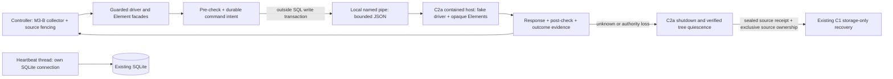

# M3-C2b — Guarded commands, dedicated profiles and heartbeat

Ngày: 2026-10-21. **OFFLINE IMPLEMENTED / VERIFIED — STOP để review.**
Baseline: [C2 design gate](global_crawler_harness_m3c2_supervision.md),
[C2a containment](global_crawler_harness_m3c2a_containment.md),
[M3-B](global_crawler_harness_m3b_implementation.md),
[C1 publication](global_crawler_harness_m3c1_publication.md).

## 1. Kết quả và boundary thực tế

Đã nối C2a với một command boundary dùng local Windows named pipe, guarded driver/
Element facades, dedicated profile lock và heartbeat thread có SQLite connection
riêng. Existing DOM collector/runner, network classifier và source/Parquet writers
được reuse. Không thêm crawler, native supervisor cạnh tranh hoặc live browser mode.

**Provider hiện chỉ là fake driver trong reviewed fixture.** Không import/tạo
SeleniumBase Driver trong worker host; không có fallback tạo browser thật. Đã reuse
`SeleniumDOMPort`, `NetworkCapture`, `run_dom_comments` thông qua managed adapter.
Chưa claim UC driver startup/profile capabilities hoặc real WebElement compatibility
được live-verified. C2c/live/M3-D chưa được bật.

Role placement có chủ đích: controller giữ M3-B collector/orchestration và các
transaction source đã fenced; C2a child giữ driver/Elements và thực thi browser
commands. Controller không giữ raw driver object. Source writes ở controller vẫn
qua source_transaction trên đúng SQLite connection, không chuyển sang writer mới.
Controller chết đóng Job Object handle và dừng contained driver host/descendants.



## 2. Files changed và compatibility

| File | Thay đổi |
|---|---|
| [browser_commands.py](../../crawler_harness/browser_commands.py) — mới | ManagedBrowserSession, driver/Element facades, command history/evidence, managed collector bridge, C1 storage-only route |
| [browser_worker.py](../../crawler_harness/browser_worker.py) — mới | C2a child IPC host, fixed offline provider, explicit operation allowlists, opaque Element registry |
| [browser_protocol.py](../../crawler_harness/browser_protocol.py) — mới | Bounded JSON messages, peer PID query, operation/CDP allowlists |
| [browser_profile.py](../../crawler_harness/browser_profile.py) — mới | Create-only dedicated profiles, physical identity, exclusive profile mutex, dirty/clean session marker |
| [heartbeat.py](../../crawler_harness/heartbeat.py) — mới | Thread-owned JobStore connection, bounded lease renewal, authority-loss signal, stop/join |
| [containment.py](../../crawler_harness/containment.py) | Extract existing unresolved-worker history check into reusable helper; same C2a eligibility/ownership behavior |
| [tiktok_adapter.py](../../crawler_harness/tiktok_adapter.py) | Optional command_boundary validation và source_gate hook bên trong existing source transaction; defaults giữ legacy fixture behavior |
| [fixtures_harness_browser.py](../../tests/fixtures_harness_browser.py) — mới | Synthetic driver/Elements, wait/crash/session/profile fault modes; không website/browser |
| [test_harness_browser_commands.py](../../tests/test_harness_browser_commands.py) — mới | 42 cases, real subprocess/SQLite/profile/heartbeat, fake driver only |
| Báo cáo này, current_task.md, work_status.md, checkpoint | Evidence và handoff |

Không sửa frozen Google, DOM collector/JS, `run_dom_comments`, SeleniumBase factory,
legacy CLI, source persistence/outbox/Parquet schema hoặc event hash semantics.
Không thêm SQLite DDL/tables/versions/PRAGMAs. Existing M1/C1 readers lọc event types
cụ thể; additive browser history không trở thành source publication events.

## 3. Browser command access audit

| Existing surface | Call sites | Managed handling |
|---|---|---|
| Driver timeouts, get, current_url | [DOM port](../../experiments/tiktok_comment_dom/probe.py#L377) | Facade gọi cùng command boundary; getters cũng có command IDs/ownership checks |
| Snapshot/scroll/reply-target JS | [snapshot](../../experiments/tiktok_comment_dom/probe.py#L401), [scroll/reply](../../experiments/tiktok_comment_dom/probe.py#L527) | execute_script qua IPC; output basic data hoặc opaque Element, không raw Python object |
| find_elements, click, displayed, parent traversal | [onboarding](../../experiments/tiktok_comment_dom/probe.py#L446) | Element facade cho text/tag/size/find/click/displayed/get_attribute; child giữ raw object |
| JS trả Element/nested Elements | [expand_reply](../../experiments/tiktok_comment_dom/probe.py#L541) | Typed result envelopes; browser dict trông giống Element tag vẫn chỉ là plain dict |
| Network.enable/get_log/getResponseBody | [NetworkCapture](../../experiments/tiktok_access_benchmark/ui_flow.py#L18) | Cùng facade; CDP chỉ Network.enable, Network.getResponseBody, Page.stopLoading; log chỉ performance |
| Runner raw port.driver/window_handles | [runner](../../experiments/tiktok_place_intelligence/probe.py#L528) | port.driver chính là facade, không raw driver; legacy code không cần sửa |
| Finally save_screenshot | [finally](../../experiments/tiktok_place_intelligence/probe.py#L569) | Guarded; chỉ đúng session evidence và adapter job/attempt evidence directories |
| Driver quit/close/service/process/executor/_execute | Không cần cho managed collector | Refuse và halt; cleanup chỉ qua C2a retained Job Object |
| SwitchTo/auth/search/UC-specific methods | Ngoài managed collection call graph hiện tại | Không expose; fail-closed, không đoán interface hay silently forward |

API thông thường không expose `__dict__`, raw parent/driver/executor hoặc allow
attribute assignment để thay guard. Element operations không trả `_parent` về
controller. Không dùng ActionChains/raw WebDriver execute như đường bypass.

Đây là **cooperative API boundary**, không phải Python/security sandbox chống
trusted-controller code cố tình reflection, sửa DB, tự dùng private IPC hoặc sửa
fixture provider. Browser text không được deserialize thành Python object/code.
Legacy/direct raw-driver callers ngoài managed path không được nâng guarantee.

## 4. Ownership và command outcomes

Mỗi command có UUID mới, exact job/attempt/generation/session scope, operation,
elapsed monotonic time và outcome. Không persist args/results, URLs, script bodies,
cookies, tokens hoặc personal browser content vào command evidence.

Protocol:

1. Validate C2a controller process/thread và retained worker handle membership;
   worker phải còn sống. Validate dedicated profile marker và session binding.
2. Trong short M1 transaction: validate current Claim/lease/lifecycle và ghi
   `browser.command_intent`. RUNNING cho collection operations; PERSISTING chỉ cho
   final screenshot, không cho navigate/click/script.
3. Release SQLite write transaction rồi dispatch đúng một JSON IPC request. Không
   giữ SQL write lock trong browser wait. Không pickle/eval/callback serialization.
4. Worker verify controller peer creation identity, session/attempt headers, bounded
   operation allowlist, pinned fake browser session/profile. Chỉ một connection.
5. Response phải đúng command/session/browser identity. Parent rechecks ownership,
   lease, lifecycle, profile/worker trước guarded `browser.command_succeeded` commit.
6. EOF/crash/timeout/invalid response/authority loss → UNKNOWN nếu đã dispatch;
   pre-dispatch rejection → REFUSED. Halt dispatch, signal heartbeat stop, invoke
   C2a owned-tree shutdown. Không retry hay replay command đã gửi.

Request/response tối đa 8 MiB, depth 30; tối đa 1,000 commands/session. Commands
sequential trên owner thread. IPC peer PID được kết hợp với retained process handle,
creation FILETIME, Windows session ID và C2a membership; không PID-only ownership.
Windows peer APIs: [server PID](https://learn.microsoft.com/en-us/windows/desktop/api/winbase/nf-winbase-getnamedpipeserverprocessid),
[client PID](https://learn.microsoft.com/en-us/windows/win32/api/winbase/nf-winbase-getnamedpipeclientprocessid).
AF_PIPE là IPC cục bộ, không HTTP/network crawl hoặc external service dependency.

Action đã dispatch **không rollback được**. UNKNOWN có thể đã tạo effect trước khi
worker bị dừng. Không trả success khi post-check thất bại. Khi stale/expired token,
không ghi completion/hold bằng token đó; durable intent và local UNKNOWN evidence
giữ uncertainty. Nếu filesystem evidence không ghi được, không suy clear từ absence;
unresolved command intent vẫn chặn session launch của job đó.

Nếu còn valid authority và job RUNNING, unknown/unsupported surface chuyển job
PAUSED_NEEDS_HUMAN. Job PERSISTING có sealed source receipt vẫn giữ receipt để
storage-only replay; lỗi final diagnostic không fabricate hoặc hủy source coverage.

## 5. Dedicated profile ownership

`DedicatedProfile.create` chỉ tạo directory mới, không stamp existing Chrome/user/
legacy profile kể cả thư mục rỗng. Metadata version 1 pin random profile ID,
physical directory resource ID và database identity. Không đọc/export auth data.

Controller giữ Global profile mutex theo physical identity suốt session, độc lập
DB/source lock C2a. Active session marker ghi trước worker launch. Foreign DB/profile
resource/session mismatch hoặc dirty marker từ crash đều fail-closed. Không clear
dirty marker chỉ vì mutex abandoned. Không có automatic adoption/release command.

Release clean marker cần **C2a retained owner quiescence**, không caller flag. Chỉ
sau verified worker exit/job zero mới clear metadata; profile lock còn giữ đến khi
source owner close. Nếu cleanup không verified hoặc profile metadata bị thay đổi,
giữ dirty marker/human hold. Marker clean là process/profile lifecycle fact, không
có nghĩa authentication clear hay provider restriction được gỡ.

Mỗi evidence/session path phải fresh. Screenshot chỉ ghi trong exact attempt roots.
Initial integration test đã bắt finally screenshot ngoài session root; fix là pin
thêm đúng adapter job/attempt root, không bỏ guard hoặc nuốt lỗi để báo pass.

## 6. Heartbeat và source/persistence integration

Heartbeat thread tự mở/đóng JobStore connection trong chính thread, không share
controller connection. Renew qua M1 heartbeat transaction; expired/stale token không
được resurrect. Loss/SQLite failure dừng renew và phát Event, không auto retry.
Main command loop nhìn Event trong wait; cleanup chạy ở C2a owner thread, không
để heartbeat thread kill process. Idle session không dispatch gì; owner close/check
mới thực hiện cleanup, không claim có background browser supervisor vô điều kiện.

M3-B source_gate là local halted/loss check **bên trong source transaction hiện có**;
không RPC hoặc browser wait dưới write lock. Existing source authority/lease precommit
checks giữ nguyên. Unknown command không được tiếp tục commit collection bằng path
này. Committed rows/events/checkpoints vẫn được bảo toàn khi worker chết.

`recover_storage` chỉ cho verified CLOSED worker với durable C2a resolution. Giữ
exclusive C2a source mutex, kiểm tra mọi prior worker intent đã resolved, rồi gọi
existing C1 recovery (C1 tự lấy DB/lake publisher locks). Source owner còn giữ lock
thì từ chối, không suy quiescent từ job receipt. Không gọi collector/browser,
không takeover, không tạo Claim mới hoặc reconstruct missing receipt.

Hai fixtures đã reconcile **1 SQLite record / 1 event / 1 Parquet row, pending=0**:
normal existing collector và crash trong finally screenshot sau receipt seal.
COMPLETE ở đây là **explicit-end synthetic fixture**, không bằng chứng TikTok live
full coverage. Repeated storage audits không thêm command/file/event.

## 7. Offline verification và evidence

Final suite: **415 passed, 2 existing Pandas warnings, 71.73s, zero skipped**.
Trong đó **42 C2b cases**, cộng toàn bộ M1/M2/M3-B/C1/C2a/TikTok legacy/Google baseline.
Không dùng số liệu cũ của C2a. Không thay dependencies để che warnings.

Coverage: valid owner; expired lease; fault-injected takeover/old generation; IPC
session/attempt mismatch; runtime profile/browser mismatch; worker crash + descendant;
authority expiry giữa action; heartbeat loss interrupting a wait; raw driver/Element/
finally/CDP bypass; profile same-process và actual cross-process contention;
thread-owned heartbeat; independent SQLite writer commit trong browser wait;
source data survives crash; missing receipt không inferred; sealed receipt replay;
repeated recovery và source ownership contention. Takeover fault fixture dùng
deliberately false admin attestation để kiểm tra fencing, không phải production
quiescence detector hoặc approved takeover flow.

Evidence: [verification](../../output/m3c2b-offline-evidence-20261021/verification.json),
[lifecycle/heartbeat/reconciliation](../../output/m3c2b-offline-evidence-20261021/lifecycle_evidence.json),
[source hashes](../../output/m3c2b-offline-evidence-20261021/source_hashes.json).
Raw fixtures `output/t8c44f/`: 38 session-end artifacts (38 separate heartbeat-thread
connections), 94 synthetic command outcomes: 56 SUCCEEDED, 11 UNKNOWN, 27 REFUSED.
Các counts này là fault-test observations, **không phải** crawler reliability rates.
Các tests không launch session (ví dụ heartbeat độc lập) không có session-end artifact.

```powershell
Set-Location '<repository-root>'
$testRoot = 'output/t' + [guid]::NewGuid().ToString('N').Substring(0,5)
if (Test-Path -LiteralPath $testRoot) { throw 'Fresh output required' }
& 'python' -B -m pytest -q --import-mode=importlib -p no:cacheprovider --basetemp $testRoot `
  tests/test_harness_browser_commands.py tests/test_harness_containment.py `
  tests/test_harness_publication.py tests/test_harness_tiktok_managed.py `
  tests/test_harness_state.py tests/test_harness_hardening.py tests/test_harness_recovery.py `
  experiments/tiktok_comment_dom/test_dom.py experiments/tiktok_comment_dom/test_replies_scroll.py `
  experiments/tiktok_comment_dom/test_persistence.py experiments/tiktok_comment_dom/test_compaction.py `
  experiments/tiktok_place_intelligence/test_live_dom_persistence.py `
  experiments/tiktok_access_benchmark/test_overture_study.py `
  experiments/tiktok_access_benchmark/test_reliability.py tests/test_google_baseline.py
```

Chỉ chọn `tests/test_harness_browser_commands.py` để chạy focused; thêm
`-k 'inflight or heartbeat or profile or ipc'` để debug nhóm liên quan.
Không có browser/live command trong deliverable này.

Whole-tree `git diff --check` còn pre-existing whitespace tại
`docs/component_registry.md:14`. Scoped source/docs whitespace và report local
links kiểm tra riêng; không sửa unrelated edits hoặc refresh Google manifest.

## 8. Rollback, limitations và readiness

- Không SQL migration. Additive history types/profile manifests không tự kích hoạt
  khi mở legacy runner. Legacy behavior giữ nguyên khi không truyền new hooks;
  legacy output/DB phải riêng, không được bypass managed ownership bằng old CLI.
- Rollback: stop dispatch, verified C2a shutdown, join heartbeat, preserve SQLite/
  outbox/receipts/evidence/profile markers. Không xóa dirty marker/intents để ép resume.
  Cần consistent SQLite backup khi quiescent và giữ private profile data ngoài Git;
  không publish runtime snapshots, profiles hoặc IPC bootstrap artifacts.
- Unknown/lost-authority closure có thể giữ C2a unresolved intent dù native tree
  đã dừng; thiếu quyền không được tự append resolution. Human resolution chưa có.
- Không durable CAPTCHA/login/403/429 source/session latch/operator release: C2c
  còn phải làm. Không suy access clear từ profile clean hoặc absence of network logs.
- UC-specific reconnect, SwitchTo/auth/search helpers và live driver provider chưa
  được hỗ trợ. Unsupported surface fail-closed; không silently forward. Actual UC
  driver capabilities/profile launch args/real Element serialization cần reviewed
  provider wiring và separate validation trước rollout, không đổi factory frozen.
- Không chống hostile code có quyền trong controller, direct DB/FS tampering hoặc
  external legacy browser access. OS scheduling/SQLite timeouts không phải hard
  real-time cancellation; gửi action rồi không thể undo effect. Process crash được
  test, không claim power-loss DB+FS atomicity.
- Không source recollection/resume policy mới, không exactly-once source collection.
  SESSION_FALLBACK/cross-run ID limitations, PARTIAL/MAX_SCROLLS semantics giữ nguyên.

**GO để review và lập kế hoạch C2c OFFLINE sau approval. NO-GO managed live/M3-D.**
C2c cần durable restriction scope/Retry-After/operator verification, không mở lại
terminal job hoặc tự retry collection. Mọi schema extension tiếp theo cần reviewed
contract/validator compatibility/backup/rollback trước khi áp dụng. STOP tại C2b.
